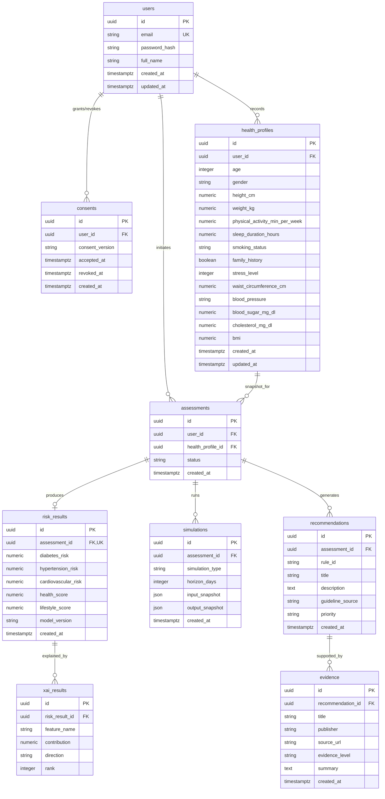

# HELIORA — Database Architecture & Schema Specification

**Document:** Database Design & Data Architecture  
**Document ID:** DB-001  
**Version:** 1.0  
**Status:** Approved  
**Related Documents:** [Architecture.md](file:///d:/heliora/docs/Architecture.md) (§7.3–7.4), [PRD.md](file:///d:/heliora/docs/PRD.md), [TASK.md](file:///d:/heliora/docs/TASK.md)  
**Target Engine:** PostgreSQL 16+  
**ORM / Migration:** SQLAlchemy 2.0 (Async) + Alembic  

---

## 1. Executive Summary

HELIORA is an AI-powered preventive health intelligence platform. The database layer is designed to store user accounts, health profiles, assessment sessions, risk model outputs, explainable AI (SHAP) attributions, simulation projections, clinical rule engine recommendations, and supporting scientific evidence.

The architecture prioritizes:
1. **Security & Privacy:** UUID primary keys prevent sequential ID enumeration; explicit consent tracking with audit timestamps; strict `ON DELETE CASCADE` ensures user data erasure upon account deletion.
2. **Clinical Data Integrity:** Check constraints enforce domain invariants (age ranges, non-negative biometric values, bounded probability and score ranges).
3. **Auditability & Traceability:** Model versions, rule IDs, and evidence sources are explicitly captured for every assessment output.

---

## 2. Entity-Relationship Diagram (ERD)



---

## 3. Detailed Table Specifications

### 3.1 `users`
Represents registered user accounts and credential hashes.

| Column | Type | Constraints | Default | Description |
|---|---|---|---|---|
| `id` | `UUID` | PK | `gen_random_uuid()` | Unique user identifier |
| `email` | `VARCHAR(320)` | Unique, Not Null | — | User email address |
| `password_hash` | `VARCHAR(128)` | Not Null | — | Bcrypt hashed password |
| `full_name` | `VARCHAR(255)` | Not Null | — | User full name |
| `created_at` | `TIMESTAMPTZ` | Not Null | `now()` | Registration timestamp |
| `updated_at` | `TIMESTAMPTZ` | Not Null | `now()` | Account update timestamp |

**Indexes:**
- `ix_users_email` (UNIQUE): Fast email login lookup.

---

### 3.2 `consents`
Records explicit user agreement to terms of service, medical disclaimer, and health data usage.

| Column | Type | Constraints | Default | Description |
|---|---|---|---|---|
| `id` | `UUID` | PK | `gen_random_uuid()` | Consent log ID |
| `user_id` | `UUID` | FK (`users.id` ON DELETE CASCADE), Not Null | — | User reference |
| `consent_version` | `VARCHAR(20)` | Not Null | `'1.0'` | Version of consent terms |
| `accepted_at` | `TIMESTAMPTZ` | Not Null | — | Timestamp when accepted |
| `revoked_at` | `TIMESTAMPTZ` | Nullable | `NULL` | Timestamp when revoked |
| `created_at` | `TIMESTAMPTZ` | Not Null | `now()` | Creation timestamp |

**Indexes:**
- `ix_consents_user_id`: Fast lookup of active user consent.

---

### 3.3 `health_profiles`
Biometric, lifestyle, and clinical input metrics.

| Column | Type | Constraints | Default | Description |
|---|---|---|---|---|
| `id` | `UUID` | PK | `gen_random_uuid()` | Profile record ID |
| `user_id` | `UUID` | FK (`users.id` ON DELETE CASCADE), Not Null | — | User reference |
| `age` | `INTEGER` | Check (`1 <= age <= 150`), Not Null | — | Age in years |
| `gender` | `VARCHAR(20)` | Not Null | — | Gender ('male', 'female', 'other') |
| `height_cm` | `NUMERIC(5,1)` | Check (`> 0`), Not Null | — | Height in centimeters |
| `weight_kg` | `NUMERIC(5,1)` | Check (`> 0`), Not Null | — | Weight in kilograms |
| `physical_activity_min_per_week` | `NUMERIC(6,1)` | Check (`>= 0`), Not Null | — | Moderate-to-vigorous exercise mins/week |
| `sleep_duration_hours` | `NUMERIC(3,1)` | Check (`0 <= sleep <= 24`), Not Null | — | Daily sleep duration in hours |
| `smoking_status` | `VARCHAR(30)` | Not Null | — | 'never', 'former', 'current' |
| `family_history` | `BOOLEAN` | Not Null | `false` | Family history of chronic diseases |
| `stress_level` | `INTEGER` | Check (`NULL` or `1 <= stress <= 10`) | `NULL` | Self-reported stress (1–10) |
| `waist_circumference_cm` | `NUMERIC(5,1)` | Check (`NULL` or `> 0`) | `NULL` | Waist circumference in cm |
| `blood_pressure` | `VARCHAR(20)` | Nullable | `NULL` | E.g. "120/80" mmHg |
| `blood_sugar_mg_dl` | `NUMERIC(6,1)` | Check (`NULL` or `> 0`) | `NULL` | Fasting blood glucose in mg/dL |
| `cholesterol_mg_dl` | `NUMERIC(6,1)` | Check (`NULL` or `> 0`) | `NULL` | Total cholesterol in mg/dL |
| `bmi` | `NUMERIC(4,1)` | Check (`NULL` or `> 0`) | `NULL` | Calculated Body Mass Index |
| `created_at` | `TIMESTAMPTZ` | Not Null | `now()` | Profile creation time |
| `updated_at` | `TIMESTAMPTZ` | Not Null | `now()` | Profile update time |

**Indexes:**
- `ix_health_profiles_user_id`: Profile history per user.

---

### 3.4 `assessments`
Represents an assessment session tying input profile snapshots to risk estimation and recommendations.

| Column | Type | Constraints | Default | Description |
|---|---|---|---|---|
| `id` | `UUID` | PK | `gen_random_uuid()` | Assessment session ID |
| `user_id` | `UUID` | FK (`users.id` ON DELETE CASCADE), Not Null | — | User reference |
| `health_profile_id` | `UUID` | FK (`health_profiles.id` ON DELETE CASCADE), Not Null | — | Profile input used |
| `status` | `VARCHAR(20)` | Check in (`pending`, `processing`, `completed`, `failed`), Not Null | `'pending'` | Processing lifecycle status |
| `created_at` | `TIMESTAMPTZ` | Not Null | `now()` | Assessment initiation timestamp |

**Indexes:**
- `ix_assessments_user_id`: Lookup by user.
- `ix_assessments_user_created` (`user_id`, `created_at` DESC): Composite index for retrieving a user's latest assessment session in $O(1)$.

---

### 3.5 `risk_results`
Outputs of the Preventive Lifestyle Risk Engine.

| Column | Type | Constraints | Default | Description |
|---|---|---|---|---|
| `id` | `UUID` | PK | `gen_random_uuid()` | Risk result ID |
| `assessment_id` | `UUID` | FK (`assessments.id` ON DELETE CASCADE), Unique, Not Null | — | 1:1 Assessment reference |
| `diabetes_risk` | `NUMERIC(5,4)` | Check (`0.0 <= risk <= 1.0`), Not Null | — | Diabetes risk probability |
| `hypertension_risk` | `NUMERIC(5,4)` | Check (`0.0 <= risk <= 1.0`), Not Null | — | Hypertension risk probability |
| `cardiovascular_risk` | `NUMERIC(5,4)` | Check (`0.0 <= risk <= 1.0`), Not Null | — | CVD risk probability |
| `health_score` | `NUMERIC(5,2)` | Check (`0.0 <= score <= 100.0`), Not Null | — | Composite health score |
| `lifestyle_score` | `NUMERIC(5,2)` | Check (`0.0 <= score <= 100.0`), Not Null | — | Composite lifestyle score |
| `model_version` | `VARCHAR(50)` | Not Null | `'1.0.0'` | ML model pipeline version |
| `created_at` | `TIMESTAMPTZ` | Not Null | `now()` | Calculation timestamp |

**Indexes:**
- `ix_risk_results_assessment_id` (UNIQUE): Fast 1:1 join with assessment.

---

### 3.6 `xai_results`
SHAP feature attribution scores ranking which lifestyle/biometric factors contributed most to the risk output.

| Column | Type | Constraints | Default | Description |
|---|---|---|---|---|
| `id` | `UUID` | PK | `gen_random_uuid()` | Attribution record ID |
| `risk_result_id` | `UUID` | FK (`risk_results.id` ON DELETE CASCADE), Not Null | — | Risk result reference |
| `feature_name` | `VARCHAR(100)` | Not Null | — | Name of biometric/lifestyle feature |
| `contribution` | `NUMERIC(8,4)` | Not Null | — | SHAP value magnitude |
| `direction` | `VARCHAR(20)` | Check in (`positive`, `negative`), Not Null | — | Risk-increasing vs risk-decreasing |
| `rank` | `INTEGER` | Check (`rank >= 1`), Not Null | — | Contribution importance rank |

**Indexes:**
- `ix_xai_results_risk_result_id`: Lookup by risk result.
- `ix_xai_results_risk_rank` (`risk_result_id`, `rank`): Composite index for ordered waterfall/spider chart rendering.

---

### 3.7 `simulations`
Records of What-If scenario adjustments and Future projected risk horizons.

| Column | Type | Constraints | Default | Description |
|---|---|---|---|---|
| `id` | `UUID` | PK | `gen_random_uuid()` | Simulation record ID |
| `assessment_id` | `UUID` | FK (`assessments.id` ON DELETE CASCADE), Not Null | — | Assessment reference |
| `simulation_type` | `VARCHAR(30)` | Check in (`future`, `what_if`), Not Null | — | Simulation mode |
| `horizon_days` | `INTEGER` | Check (`NULL` or `> 0`), Nullable | `NULL` | Time projection (30, 90, 180 days) |
| `input_snapshot` | `JSON` | Not Null | — | Snapshot of adjusted lifestyle inputs |
| `output_snapshot` | `JSON` | Not Null | — | Simulated delta scores and risks |
| `created_at` | `TIMESTAMPTZ` | Not Null | `now()` | Simulation execution time |

**Indexes:**
- `ix_simulations_assessment_id`: Lookup by assessment session.

---

### 3.8 `recommendations`
Actionable lifestyle guidance produced by the clinical rule engine.

| Column | Type | Constraints | Default | Description |
|---|---|---|---|---|
| `id` | `UUID` | PK | `gen_random_uuid()` | Recommendation record ID |
| `assessment_id` | `UUID` | FK (`assessments.id` ON DELETE CASCADE), Not Null | — | Assessment reference |
| `rule_id` | `VARCHAR(50)` | Not Null | — | Deterministic rule identifier |
| `title` | `VARCHAR(255)` | Not Null | — | Action headline |
| `description` | `TEXT` | Not Null | — | Plain-text non-diagnostic guidance |
| `guideline_source` | `VARCHAR(255)` | Not Null | — | Clinical origin (e.g. AHA/ACC, WHO, Kemenkes) |
| `priority` | `VARCHAR(20)` | Check in (`high`, `medium`, `low`), Not Null | — | Urgency level |
| `created_at` | `TIMESTAMPTZ` | Not Null | `now()` | Generation timestamp |

**Indexes:**
- `ix_recommendations_assessment_id`: Lookup recommendations for assessment report.

---

### 3.9 `evidence`
Scientific literature, clinical trial findings, and guideline citations supporting recommendations.

| Column | Type | Constraints | Default | Description |
|---|---|---|---|---|
| `id` | `UUID` | PK | `gen_random_uuid()` | Evidence record ID |
| `recommendation_id` | `UUID` | FK (`recommendations.id` ON DELETE SET NULL), Nullable | `NULL` | Linked recommendation (if specific) |
| `title` | `VARCHAR(255)` | Not Null | — | Paper / guideline publication title |
| `publisher` | `VARCHAR(255)` | Not Null | — | Publishing authority (e.g. AHA, ADA, WHO) |
| `source_url` | `VARCHAR(1024)` | Not Null | — | Verified canonical source URL |
| `evidence_level` | `VARCHAR(50)` | Nullable | `NULL` | E.g. 'Level 1A', 'Grade A' |
| `summary` | `TEXT` | Not Null | — | Synthesized clinical rationale summary |
| `created_at` | `TIMESTAMPTZ` | Not Null | `now()` | Record creation timestamp |

**Indexes:**
- `ix_evidence_recommendation_id`: Lookup citations per recommendation.

---

## 4. Design Decisions & Rationale

### 4.1 UUID Primary Keys
- **Decision:** Use RFC 4122 v4 UUIDs for all primary keys (`UUID(as_uuid=True)` in Python, `UUID` in PostgreSQL).
- **Rationale:** Prevents enumeration and scraping attacks against user IDs or health assessment reports. Allows decentralized ID generation on backend services without roundtripping to sequence generators.

### 4.2 SQLAlchemy 2.0 Async + AsyncPG
- **Decision:** Standardize on SQLAlchemy 2.0 declarative models with `Mapped[T]` typing and `asyncpg` async driver.
- **Rationale:** Aligns with FastAPI's asynchronous ASGI concurrency model, ensuring high throughput under concurrent assessment loads without blocking worker threads.

### 4.3 Database Migrations via Alembic
- **Decision:** Version control schema evolution using Alembic revisions located in `apps/api/alembic/versions/`.
- **Rationale:** Provides deterministic, reproducible schema upgrades across local Docker development, CI testing pipelines, and production deployments.

### 4.4 Cascade Deletion Policy
- **Decision:** `users` table cascades deletions to `consents`, `health_profiles`, and `assessments`.
- **Rationale:** Fully satisfies data minimization and user erasure compliance (GDPR / UU PDP Indonesia / PRD §privacy).

### 4.5 Indexing Strategy
- Single-column indexes on all Foreign Keys to prevent table scans on joins.
- Unique index on `users.email` for authentication.
- Composite index `(user_id, created_at)` on `assessments` to optimize "Get Latest Assessment" dashboard queries.
- Composite index `(risk_result_id, rank)` on `xai_results` for ordered retrieval of top SHAP contributors.

---

## 5. Verification & Migration Commands

```bash
# Navigate to API workspace
cd apps/api

# Run migrations online (requires running PostgreSQL)
alembic upgrade head

# Rollback migration
alembic downgrade -1

# Generate SQL script offline
alembic upgrade head --sql
```
