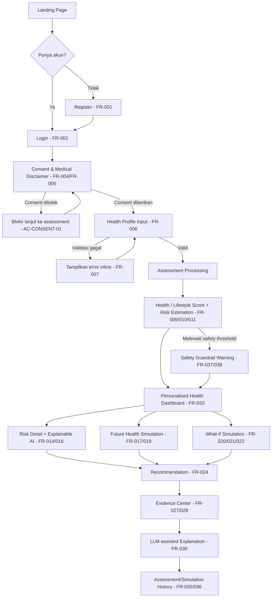

# HELIORA — UI/UX Design Document

## 0. Document Control

| Item | Keterangan |
|---|---|
| Nama Dokumen | HELIORA — UI/UX Design Document (`design.md`) |
| Turunan dari | HELIORA PRD v1.1 (Revised, 19 Agustus 2026) |
| Kedudukan Dokumen | Supporting Document — setara dengan "UI/UX Guideline" pada PRD §1.7 |
| Status | v1.0 — Final untuk dibagikan ke tim (poin di §14 Open Questions masih perlu keputusan tim sebelum implementasi) |
| Dibuat | 24 Agustus 2026 |

### 0.1 Kedudukan dalam Source of Truth Hierarchy

Mengikuti PRD §20.23, dokumen ini berada di level **Architecture/Design**, bukan di atas PRD:

```text
PRD (Requirements, Scope, Business Rules, Acceptance Criteria)
        │
        ▼
design.md  ← dokumen ini (Information Architecture, User Flow, Page Design)
        │
        ▼
Implementation (Frontend Next.js)
```

Artinya: dokumen ini **tidak boleh mengubah** scope, business rule, atau safety boundary yang sudah ditetapkan PRD. Jika ada perbedaan, PRD yang menang.

### 0.2 Cakupan & Batasan

- Dokumen ini menerjemahkan Chapter 3 (Product Overview), Chapter 6 (Scope), Chapter 7 (Persona), Chapter 8 (User Journey), Chapter 9 (Functional Requirements), dan Chapter 13 (NFR) PRD menjadi **information architecture, user flow rinci, dan spesifikasi halaman**.
- **Login/Sign In, Landing Page, Dashboard, dan halaman user** diturunkan langsung dari requirement PRD (FR/BR/AC direferensikan di tiap bagian).
- **Admin Panel tidak disebutkan sama sekali di PRD** (tidak ada satu pun mention "admin" di seluruh dokumen 20 bab). Bagian admin pada dokumen ini adalah **usulan tambahan** (lihat §11) yang perlu divalidasi PM/Solution Architect sebelum dianggap requirement resmi — bukan turunan langsung PRD.
- Palet warna & tipografi (§2) sudah didefinisikan sebagai keputusan tim (bukan lagi placeholder); spacing scale & komponen Figma detail masih menyusul di iterasi hi-fi. Dokumen ini tetap fokus ke **struktur, hierarki informasi, dan perilaku (behavior)** halaman, sesuai level "UI/UX Guideline" yang dimaksud PRD §1.7.

---

## 1. Prinsip Desain

Diturunkan langsung dari PRD §3.13 (User Experience Principle), §5.5 (Product Principles), §13.6–13.7 (Usability & Accessibility):

| # | Prinsip | Implikasi Desain |
|---|---|---|
| 1 | **Understand Before Acting** | Setiap layar hasil (risk, score) selalu menampilkan penjelasan sebelum CTA aksi ditampilkan. |
| 2 | **Explainable by Default** | Tidak ada angka mentah tanpa penjelasan bahasa natural di sebelahnya (lihat PRD §13.6.1 — dilarang menampilkan `Risk Score: 0.67342` telanjang). |
| 3 | **Preventive, Not Diagnostic** | Copy, warna, dan ikon tidak boleh terlihat seperti hasil lab/diagnosis medis. Disclaimer selalu visible di halaman hasil, simulasi, dan rekomendasi (FR-005). |
| 4 | **Evidence-Based** | Rekomendasi penting selalu punya tautan "Lihat Evidence" (BR-EVIDENCE-001). |
| 5 | **Actionable** | Insight harus berujung pada 1 tindakan konkret, bukan sekadar informasi. |
| 6 | **Simple / Non-Alarming** | Bahasa awam, bertahap (progressive disclosure), tidak menakut-nakuti meski risiko tinggi (FR-037: tidak boleh menyatakan pengguna "punya penyakit X"). |
| 7 | **User-Controlled Exploration** | What-if & Future Health Simulation harus terasa reversible dan aman untuk "dicoba-coba" (BR-SIM-007: no permanent mutation). |
| 8 | **Accessible** | Kontras cukup, status tidak hanya bergantung warna, label jelas pada elemen interaktif (PRD §13.7). |

---

## 2. Tema & Visual Language (Design Tokens)

> Palet warna, tipografi, dan token visual HELIORA dirancang dengan prinsip **Editorial Minimalism** yang presisi, hangat, dan terpercaya — memadukan panduan *Apple Human Interface Guidelines (HIG)*, standar tipografi editorial modern, dan larangan mutlak terhadap ornamen generik seperti pill chips.

### 2.1 Brand & Filosofi Warna

- **Warna utama: Forest Green (`#0F7A4E`)** — selaras prinsip "Preventive First" (PRD §5.5.1). Nuansa yang dipakai bukan hijau "steril rumah sakit", melainkan hijau daun/forest yang hangat dan berwibawa, memastikan platform tidak berkesan seperti aplikasi diagnosis klinis (selaras Prinsip #3 "Preventive, Not Diagnostic").
- **Tipografi Editorial Murni untuk Status:** Status risiko ("Lower", "Moderate", "Higher") disajikan menggunakan **tipografi editorial murni** (`font-mono text-xs font-bold tracking-wider uppercase` + ikon semantik garis tipis) tanpa kontainer kapsul lonjong (`rounded-full`), tanpa background warna oval, dan tanpa dot berkedip. Ini memastikan tampilan tetap bersih, berwibawa, dan tidak tertukar dengan tombol aksi/CTA.
- **Light + Dark Mode** didukung penuh sejak MVP dengan penyesuaian kontras lumiansi terverifikasi WCAG AAA/AA.
- **Tipografi Dwi-Sistem:**
  - **Primary Sans:** [Plus Jakarta Sans](https://fonts.google.com/specimen/Plus+Jakarta+Sans) untuk heading hero, judul kartu, copy naratif, dan label UI.
  - **Accent Monospace:** System Monospace / JetBrains Mono (`font-mono`) untuk section eyebrow, status risiko klinis, angka skor tabular, dan metadata kalkulasi.

### 2.2 Palet Warna — Light Mode

**Primary (Hijau / Brand)**

| Token | Hex | Kegunaan | Kontras Terverifikasi |
|---|---|---|---|
| `primary-50` | `#F0FDF6` | Background section alternate, hover subtle | — (bukan konteks teks) |
| `primary-100` | `#DCFCE9` | Background highlight halus, kartu aksen lembut | — |
| `primary-300` | `#86E8B0` | Border aktif, aksen grafis visual | — |
| `primary-500` | `#22B573` | Ikon brand, aksen grafis non-teks | ❌ 2.65:1 (gagal AA sbg teks) |
| `primary-700` | `#0F7A4E` | Tombol primer (bg + teks putih), link aktif, teks status "Lower Risk" | ✅ AA — 5.37:1 (di atas putih) |
| `primary-800` | `#0D5F3F` | Hover/active state tombol primer | ✅ AAA — 7.70:1 |

**Neutral**

| Token | Hex | Kegunaan | Kontras |
|---|---|---|---|
| `neutral-0` | `#FFFFFF` | Background utama | — |
| `neutral-50` | `#F7F9F8` | Background section alternate (warm editorial) | — |
| `neutral-200` | `#DEE5E1` | Border / divider halus | — |
| `neutral-700` | `#3A423D` | Body text naratif | ✅ AAA — 10.36:1 |
| `neutral-900` | `#14201A` | Heading utama & judul kartu | ✅ AAA — 16.78:1 |

**Semantic Status (Muted & Non-Alarming)**

Warna status risiko sengaja dirancang hangat dan terkalibrasi (*non-alarming*), bukan merah sirine darurat yang menakut-nakuti pengguna:

| Token | Hex | Kegunaan | Kontras |
|---|---|---|---|
| `emerald-700` | `#047857` | Teks status & ikon "Lower Risk" | ✅ AAA — 7.20:1 |
| `amber-700` | `#B45309` | Teks status & ikon "Moderate Risk" | ✅ AA — 5.80:1 |
| `rose-700` | `#BE123C` | Teks status & ikon "Higher Risk" (warm clay-rose) | ✅ AA — 6.10:1 |

### 2.3 Palet Warna — Dark Mode

Dark mode bukan sekadar invert dari light mode — tone permukaan menggunakan palet *warm forest dark* (`#0E1512` dan `#182620`) dengan aksen semantik yang ditingkatkan luminansinya agar terbaca tajam:

| Token | Hex | Kegunaan | Kontras (di atas `surface`) |
|---|---|---|---|
| `bg-base` (dark) | `#0E1512` | Background utama (hijau-hitam hangat) | — |
| `surface` (dark) | `#182620` | Card, container, panel konten solid | — |
| `surface-hover` (dark) | `#22332B` | Hover/active surface | — |
| `border` (dark) | `#2A3A32` | Divider dan outline kartu | — |
| `text-primary` (dark) | `#EAF3EE` | Body text utama | ✅ AAA — 13.88:1 |
| `text-secondary` (dark) | `#A9B8B0` | Caption, metadata, secondary text | ✅ AAA — 7.61:1 |
| `emerald-400` (dark) | `#34D399` | Teks status & ikon "Lower Risk" | ✅ AAA — 8.40:1 |
| `amber-400` (dark) | `#FBBF24` | Teks status & ikon "Moderate Risk" | ✅ AAA — 9.41:1 |
| `rose-400` (dark) | `#FB7185` | Teks status & ikon "Higher Risk" | ✅ AA — 5.85:1 |

---

### 2.4 Aturan Desain Mutlak: Larangan Pill Chips & Standar Tipografi Editorial

Sesuai aturan ketat [.agents/rules/no-pill-chips.md](file:///C:/Users/Lenovo/Documents/GitHub/heliora/heliora/.agents/rules/no-pill-chips.md) dan standar editorial HELIORA:

#### 1. LARANGAN MUTLAK (STRICT BAN)
AI dan pengembang **DILARANG KERAS** membuat atau memunculkan elemen:
- **Pill Chips / Oval Badges**: Kontainer kapsul lonjong (`rounded-full` dengan padding `px-3 py-1`, background warna tipis, dan border) yang diletakkan mengambang di atas heading, hero, section header, maupun di dalam kartu.
- **Dot Indikator Dekoratif**: Dot kecil berkedip (`w-2 h-2 rounded-full animate-pulse`) di dalam kapsul.
- **Badge Kapsul Status**: Membungkus teks status (seperti "AUC-ROC", "Terenkripsi", "Langkah X", "Lower", "Moderate", "Higher") ke dalam chip oval.

#### 2. STANDAR PENGGANTI (EDITORIAL MINIMALISM)
1. **Section Eyebrow / Kategori:**
   Gunakan tipografi bersih murni:
   `text-xs font-mono font-bold tracking-widest text-brand-900/40 uppercase mb-3`
   (Tanpa latar belakang kapsul, tanpa border, tanpa dot).
2. **Hero Section:**
   Judul utama (H1) harus berdiri sendiri secara gagah, lapang, dan bersih di puncak hierarki visual tanpa dihiasi chip mengambang di atasnya.
3. **Status Risiko & Metrik:**
   Tampilkan sebagai teks tipografi berbobot (*plain text*) sejajar dengan ikon semantik garis tipis (Lucide outline), tanpa kontainer kapsul:
   - **Lower:** `text-xs font-mono font-bold tracking-wider text-emerald-700 dark:text-emerald-400` dengan ikon `CheckCircle2`.
   - **Moderate:** `text-xs font-mono font-bold tracking-wider text-amber-700 dark:text-amber-400` dengan ikon `AlertCircle`.
   - **Higher:** `text-xs font-mono font-bold tracking-wider text-rose-700 dark:text-rose-400` dengan ikon `AlertTriangle`.
4. **Terminologi Estimasi:**
   Sesuai PRD §17.37A, seluruh copy UI wajib menggunakan istilah **"estimated risk"** atau **"estimasi risiko"**, bukan "probability" atau "peluang mutlak".

---

### 2.5 Tipografi, Skor & Ikonografi

- **Font Heading & Body:** Plus Jakarta Sans (Weight 400 normal, 500 medium, 600 semibold, 700 bold).
- **Tabular Figures & Metrics:** Angka skor besar (Health Score, Lifestyle Score) dan data angka simulasi wajib menggunakan angka tabular (`font-mono` atau `tabular-nums`) agar perbandingan digit sejajar rapi.
- **Prinsip "Explainable by Default":** Skor angka tidak boleh ditampilkan sendirian tanpa label interpretasi teks bahasa awam di sampingnya (misal: "78 — Kondisi Baik", bukan `78` telanjang).
- **Ikonografi:** Outline stroke minimalis berbobot 1.5px–1.75px dari [Lucide React](https://lucide.dev/). Hindari ikon bertipe solid/filled tebal yang terkesan berat atau kartun.

### 2.6 Komponen Disclaimer Medis (Medical Disclaimer Component)

Sesuai ketentuan statutori PRD FR-005, disclaimer medis adalah pesan keselamatan yang wajib tampil secara kata-per-kata:

> *"HELIORA adalah alat bantu preventive health berbasis lifestyle dan AI. Hasil yang diberikan merupakan estimasi dan simulasi berdasarkan data dan model yang digunakan, bukan diagnosis medis dan bukan pengganti konsultasi tenaga kesehatan."*

**Aturan Penempatan & Format:**
- **Selalu Solid / Opaque:** Ditampilkan di atas background solid netral (`neutral-50` / `surface`), teks `neutral-700` / `text-secondary`, teks biasa tanpa material glass, dan **TIDAK PERNAH** berbentuk pill badge/chip.
- **Lokasi Terbatas (4 Titik Data):** Disclaimer hanya wajib muncul di 4 area terautentikasi:
  1. Halaman Onboarding Consent (`/onboarding/consent`).
  2. Ringkasan Hasil Asesmen & Dashboard Risiko (`/dashboard`, `/dashboard/risk/:disease`).
  3. Antarmuka Simulasi (`/dashboard/simulation/what-if`).
  4. Halaman Rekomendasi Tindakan (`/dashboard/recommendations`).
- **Landing Page Publik:** Tidak menampilkan banner disclaimer mengambang agar pesan pengenalan produk tetap fokus pada nilai preventif dan edukasi gaya hidup.

### 2.7 Material — Glassmorphism (Apple Liquid Glass Standard)

Mengadopsi filosofi *Liquid Glass* dari Apple Human Interface Guidelines secara selektif:

- **Hanya untuk Lapisan Kontrol/Navigasi:** Digunakan eksklusif untuk elemen navigasi yang mengambang di atas konten yang bergulir (*scrolling*):
  - Sticky Navbar di Landing Page & aplikasi (`backdrop-blur-md bg-white/70 dark:bg-[#0E1512]/75 border-b border-black/[0.06] dark:border-white/[0.08]`).
  - Floating bottom action controls saat navigasi simulasi.
  - Backdrop modal dialog.
- **DILARANG untuk Konten Data:** Kartu data kesehatan, form input formulir, teks hasil asesmen, dan komponen disclaimer wajib berupa **permukaan solid/opaque** demi menjamin keterbacaan kontras 100% tanpa gangguan background.
- **Anti-Stacking:** Dilarang keras menumpuk dua atau lebih lapisan kaca (glass over glass).
- **Aksesibilitas:** Menghormati media query `prefers-reduced-transparency` dengan beralih otomatis ke solid background tanpa blur.

### 2.8 Referensi Komponen — shadcn/ui & Editorial Standard

Komponen UI dibangun mengacu pada pola arsitektur [shadcn/ui](https://ui.shadcn.com/) dengan penyelarasan token editorial:
- **Card:** `Card` solid (`rounded-2xl`, border halus `border-neutral-200/80 dark:border-neutral-800`, `shadow-sm` lembut).
- **RiskStatusIndicator:** Menggantikan komponen badge oval lama dengan baris status teks editorial murni (`[Icon] LABEL` dengan styling semantik `font-mono`).
- **Button:** Tombol primer berujung `rounded-xl` atau `rounded-lg` tegas (bukan `rounded-full` kapsul), dengan kontras teks putih solid di atas `primary-700`.

---

## 3. Information Architecture (Sitemap)

```text
PUBLIC (unauthenticated)                         AUTHENTICATED (user)
├── / (Landing Page - 8-Section Bento)            ├── /onboarding/consent (Langkah 01/02)
├── /login (Sign In - Centered Card + Google)     ├── /onboarding/health-profile (Langkah 02/02 - 3-Step)
├── /register (Sign Up - Centered Card + Strength)├── /dashboard (Ringkasan Klinis & Hub Inti)
├── /terms (Ketentuan Layanan)                    │   ├── /dashboard/risk/:disease (diabetes, hypertension, cardiovascular)
├── /privacy (Kebijakan Privasi)                  │   ├── /dashboard/simulation/what-if (Interactive Simulator)
└── /forgot-password *usulan*                     │   ├── /dashboard/simulation/future (Proyeksi Horison 30/90/180 Hari)
                                                  │   ├── /dashboard/recommendations (Rencana Tindakan Klinis)
ROUTE ALIASES (PRD Parity & Deep Links)           │   └── /dashboard/evidence (Pusat Bukti Medis Terakreditasi)
├── /simulation/what-if  ──► /dashboard/simulation/what-if
├── /simulation/future   ──► /dashboard/simulation/future
├── /evidence            ──► /dashboard/evidence
└── /assessment/processing ──► /dashboard

ADMIN *usulan tambahan, lihat §10*
├── /admin/dashboard
├── /admin/users
├── /admin/knowledge-base (Evidence/RAG)
├── /admin/recommendation-rules
├── /admin/model-monitoring
└── /admin/audit-log
```

Sesuai BR-AUTH-001: user tidak login hanya boleh mengakses halaman di grup **PUBLIC**. Semua route di bawah `/dashboard` dan `/onboarding` wajib redirect ke `/login` jika belum terautentikasi (dilindungi oleh middleware Supabase session guard dan `useRequireAuth`). Sesuai PRD §8, alias route tingkat atas (`/evidence`, `/simulation/what-if`, `/simulation/future`) dipertahankan secara transparan dengan meneruskan seluruh parameter pencarian (*query params*) ke rute `/dashboard/...`.

---

## 4. End-to-End User Flow (Detail)

Ini adalah versi rinci dari High-Level User Flow PRD §3.14, digabung dengan tahapan Chapter 8 (User Journey Stage 1–13). Ditambahkan decision point yang belum eksplisit di PRD (consent ditolak, validasi gagal, safety threshold).



### 4.1 Tabel Tahapan (referensi PRD Chapter 8)

| Tahap | Halaman | PRD Ref | Exit Criteria |
|---|---|---|---|
| Discovery | Landing Page | §8.3 | User paham value prop & klik CTA |
| Auth | Register/Login | §9.3 | Session terbentuk |
| Onboarding & Consent | Consent screen | §8.4, FR-004 | Consent = true |
| Health Profile Input | Multi-step form | §8.5, FR-006 | Semua required field valid |
| Health Assessment | Loading/processing | §8.6 | Score & risk tersedia |
| Dashboard | Dashboard | §8.7, FR-033 | User mengakses minimal 1 detail lanjutan |
| Risk Estimation & XAI | Risk Detail | §8.8–8.9, FR-014 | User memahami "mengapa" |
| Future Health Simulation | Simulation page | §8.10, FR-017 | User melihat proyeksi 30/90/180 hari |
| What-if Simulation | Simulation page | §8.11, FR-020 | User membandingkan current vs simulated |
| Recommendation | Recommendation page | §8.12, FR-024 | User melihat prioritas rekomendasi |
| Evidence Center | Evidence page | §8.13, FR-027 | User membuka minimal 1 sumber evidence |
| LLM Explanation | Panel penjelasan | §8.14, FR-030 | — |
| Safety Guardrail | Modal peringatan | §8.15, FR-037 | Muncul hanya jika threshold terlampaui |

---

## 5. Spesifikasi Halaman — Public

### 5.1 Landing Page (`/`)

Landing page HELIORA mengadopsi arsitektur **Editorial Bento Grid 8-Section** yang lapang, informatif, dan tidak templated — berpedoman penuh pada standar tipografi editorial murni, larangan pill chips, dan prinsip "Understand Before Acting".

```text
┌─────────────────────────────────────────────────────────────────┐
│ SECTION 1: STICKY GLASS NAVBAR                                 │
│ [HELIORA Logo]       Fitur   Alur   Kemampuan   Bukti   FAQ     │
│                                            [Masuk] [Mulai Asesmen]
├─────────────────────────────────────────────────────────────────┤
│ SECTION 2: HERO & INTERACTIVE PATTERN FLOW                      │
│ Eyebrow: PREVENTIVE HEALTH INTELLIGENCE                         │
│ Headline: Predict Today. Prevent Tomorrow.                      │
│ Subheadline: Pahami pola risiko gaya hidup sebelum berkembang   │
│ menjadi keluhan kronis melalui pendekatan AI terkalibrasi.      │
│ CTAs: [Mulai Asesmen Gratis]   [Pelajari Metodologi →]          │
│ Visual: Bilateral Pattern Flow Canvas + Layered Health Picture  │
├─────────────────────────────────────────────────────────────────┤
│ SECTION 3: MEMAHAMI POLA KESEHATAN SEBELUM TERLAMBAT            │
│ 3 Kartu Bento Analisis:                                         │
│ 1. Gaya Hidup & Faktor Risiko (Aktivitas, tidur, nutrisi)       │
│ 2. Penurunan Risiko Bertahap (Estimasi berbasis lifestyle)      │
│ 3. Pendekatan Multidisiplin (Pedoman klinis terverifikasi)      │
├─────────────────────────────────────────────────────────────────┤
│ SECTION 4: GAMBARAN UTUH PROFIL KESEHATAN KAMU                  │
│ Isometric Visual Architecture (3 SVG Isometric Planes):         │
│ • Bidang 1: Input Catatan Gaya Hidup (Lifestyle Record)         │
│ • Bidang 2: AI & Machine Learning Risk Engine                   │
│ • Bidang 3: Proyeksi Risiko & Rekomendasi Terarah               │
├─────────────────────────────────────────────────────────────────┤
│ SECTION 5: FITUR UTAMA UNTUK KEPUTUSAN KESEHATAN YANG JELAS     │
│ 6 Kartu Kemampuan Inti (Editorial Bento):                       │
│ 1. Profil Risiko Terintegrasi (Kardiometabolik komprehensif)    │
│ 2. Faktor Penjelas Interaktif / XAI (Transparansi SHAP)         │
│ 3. Simulasi Arah & Skenario / What-If (Eksplorasi aman)         │
│ 4. Rekomendasi Terarah & Berbasis Bukti (Rule-based klinis)     │
│ 5. Pusat Bukti Klinis / Evidence Center (Sitasi transparan)     │
│ 6. Pemantauan Berkelanjutan (Evaluasi berkala)                  │
├─────────────────────────────────────────────────────────────────┤
│ SECTION 6: DASAR KLINIS & METODOLOGI TRANSPARAN                 │
│ Eyebrow: DUKUNGAN KONSENSUS & PANDUAN RESMI                     │
│ Logo/Teks Strip: WHO · Kemenkes RI · CDC · PERKENI · PERKI      │
├─────────────────────────────────────────────────────────────────┤
│ SECTION 7: PERTANYAAN UMUM (FAQ ACCORDION)                      │
│ Accordion interaktif seputar batasan preventif, privasi data,   │
│ dan validitas metodologi non-diagnosis.                         │
├─────────────────────────────────────────────────────────────────┤
│ SECTION 8: FINAL CTA BANNER & FOOTER                            │
│ Headline: Mulai Langkah Preventif Kamu Hari Ini                 │
│ CTA: [Mulai Asesmen Gratis]                                     │
│ Footer: Navigasi Tautan, Hak Cipta, dan Legal Terms             │
└─────────────────────────────────────────────────────────────────┘
```

**Catatan Desain & Batasan Mutlak:**
- **Tanpa Pill Chips:** Sesuai §2.4, tidak ada chip kapsul lonjong mengambang di atas judul hero maupun di dalam kartu. Eyebrow disajikan dengan tipografi mono bersih (`text-xs font-mono font-bold tracking-widest text-brand-900/40 uppercase mb-3`).
- **Tanpa Medical Disclaimer Mengambang di Publik:** Sesuai PRD FR-005, disclaimer wajib dihadirkan pada 4 titik autentikasi yang memproses data riil pengguna (Onboarding, Hasil Asesmen, Simulasi, Rekomendasi). Landing page berfokus pada edukasi preventif dan value proposition tanpa clutter banner disclaimer.
- **Visual Non-Medis:** Selaras §3.19, dilarang menampilkan ikon alat medis klinis (stetoskop, jarum suntik, silang merah). Ilustrasi berpusat pada aliran data gaya hidup, visual isometrik mesin AI, dan kanvas partikel interaktif.

---

### 5.2 Register (`/register`) — FR-001

| Field | Validasi |
|---|---|
| Nama Lengkap | required, minimal 2 karakter |
| Email | required, format email valid, unik |
| Password | required, minimal 8 karakter, hashed via bcrypt di backend |
| Konfirmasi Password | required, harus identik dengan Password |
| Checkbox Syarat & Ketentuan | required, dilengkapi interactive tooltip peringatan jika terlewat |

- **Integrasi Supabase Auth & Google OAuth:** Mendukung registrasi via email/password maupun one-click Google Sign-in ([FE-012](file:///C:/Users/Lenovo/Documents/GitHub/heliora/heliora/docs/TASK.md#L1719)).
- **Layout:** Mengadopsi tata letak Centered Auth Container (`variant="centered"` di [auth-layout.tsx](file:///C:/Users/Lenovo/Documents/GitHub/heliora/heliora/apps/web/src/components/auth-layout.tsx)) yang fokus dan bersih.
- **Password Strength:** Dilengkapi visual dynamic 4-bar indicator kompleksitas kata sandi.
- **Syarat & Ketentuan:** Dilengkapi interactive tooltip peringatan amber (`TriangleAlert`) jika checkbox belum dicentang.
- **Privacy Note:** Menampilkan jaminan privasi data di bawah tombol submit.
- **Scrollbar:** Menggunakan utilitas `no-scrollbar` agar formulir autentikasi tampil bersih tanpa scrollbar vertikal.
- Setelah registrasi sukses → diarahkan ke alur Onboarding Consent (`/onboarding/consent`).

---

### 5.3 Login / Sign In (`/login`) — FR-002

Halaman login HELIORA mengadopsi arsitektur **Centered Auth Container** (`variant="centered"` di [auth-layout.tsx](file:///C:/Users/Lenovo/Documents/GitHub/heliora/heliora/apps/web/src/components/auth-layout.tsx)) yang bersih, terfokus, dan terintegrasi langsung dengan Supabase OAuth:

```text
┌─────────────────────────────────────────────┐
│                 [❤️ Emblem]                  │
│              Masuk ke HELIORA               │
│                                             │
│  ┌───────────────────────────────────────┐  │
│  │ [Email                              ] │  │
│  │ [Kata Sandi                   (👁)] │  │
│  └───────────────────────────────────────┘  │
│                                             │
│  [               Masuk                  ]   │
│                                             │
│  ────────────────── atau ──────────────────  │
│                                             │
│  [  G   Google                          ]   │
│                                             │
│         Lupa email atau kata sandi?         │
│                 Buat akun                   │
├─────────────────────────────────────────────┤
│ © HELIORA Inc.   Ketentuan Layanan · Privasi│
└─────────────────────────────────────────────┘
```

**Fitur & Komponen Kunci:**
- **Branding Header:** Menampilkan logo emblem Heartbeat di dalam rounded-xl container (`bg-brand-900 text-white`) dan judul h1 tegas.
- **Toggle Password:** Tombol ikon `IconEye`/`IconEyeOff` di sisi kanan input password untuk fleksibilitas pengecekan kata sandi.
- **Google OAuth (One-Click):** Tombol resmi Google via Supabase Auth ([FE-012](file:///C:/Users/Lenovo/Documents/GitHub/heliora/heliora/docs/TASK.md#L1719)) diletakkan di bawah pemisah horizontal "atau".
- **Floating Alert Tooltip:** Menampilkan pesan galat autentikasi via `FormAlertTooltip` yang dapat di-dismiss.
- **Routing Cerdas Pasca-Login (Consent-Aware Routing):**
  - Sistem memeriksa status consent pengguna via `apiClient.consent.getStatus()`.
  - Jika consent sudah aktif (`has_active_consent: true`) → diarahkan ke `/dashboard`.
  - Jika belum memberikan consent → diarahkan ke alur onboarding awal (`/onboarding/consent`).
- **Footer Minimalis:** Footer permanen dengan tautan Ketentuan Layanan (`/terms`) dan Privasi Data (`/privacy`).
- **Dual-Layout Architecture:** Komponen penampung [auth-layout.tsx](file:///C:/Users/Lenovo/Documents/GitHub/heliora/heliora/apps/web/src/components/auth-layout.tsx) mendukung mode utama `centered` (aktif digunakan) dan varian sekunder `split` (3-pilar bento), siap beradaptasi secara mulus.
- **Keamanan Kredensial:** Pesan error bersifat aman dari segi keamanan (generik: *"Gagal masuk. Pastikan email dan kata sandi Anda benar."* untuk mencegah *user enumeration attack*).

### 5.4 Forgot Password (`/forgot-password`) — *usulan, tidak ada di PRD*

PRD tidak mendefinisikan reset password (hanya FR-001 Register, FR-002 Login, FR-003 Logout). Halaman ini diusulkan sebagai kebutuhan dasar SaaS auth standar; sifatnya **bukan requirement resmi** — perlu ditambahkan ke FR jika disetujui tim (misal FR-001A).

---

## 6. Spesifikasi Halaman — Onboarding

### 6.1 Consent & Medical Disclaimer (`/onboarding/consent`) — FR-004, FR-005, BR-CONSENT-001/002

Halaman persetujuan privasi dirancang terpusat (*centered container*) dengan kartu glassmorphic (`bg-white/80 backdrop-blur-xl border border-brand-900/10 rounded-3xl p-6 sm:p-8`) dan ambient glow halus di latar belakang:

```text
┌─────────────────────────────────────────────────────────────┐
│                       [H] HELIORA                           │
│     Langkah 01 / 02 · Persetujuan Privasi & Etika Data      │
│                 Sebelum Memulai Asesmen                     │
│                                                             │
│ ┌───────────────────────────┐ ┌───────────────────────────┐ │
│ │ 🛡 Estimasi Risiko Presisi │ │ 📈 Health & Lifestyle Score│ │
│ │    Kalkulasi probabilitas │ │    Skor komprehensif      │ │
│ │    risiko kardiometabolik │ │    kualitas gaya hidup    │ │
│ ├───────────────────────────┤ ├───────────────────────────┤ │
│ │ ✨ Simulasi Masa Depan    │ │ 🩺 Rekomendasi Preventif  │ │
│ │    Proyeksi dinamis       │ │    Panduan pencegahan     │ │
│ │    dampak kebiasaan       │ │    tervalidasi klinis     │ │
│ └───────────────────────────┘ └───────────────────────────┘ │
│                                                             │
│ ┌─────────────────────────────────────────────────────────┐ │
│ │ ⚠ Disclaimer Medis (FR-005 Solid Banner)                │ │
│ │ "HELIORA adalah alat bantu preventive health..."        │ │
│ └─────────────────────────────────────────────────────────┘ │
│                                                             │
│ ┌─────────────────────────────────────────────────────────┐ │
│ │ [✓] Saya memahami dan menyetujui pemrosesan data gaya   │ │
│ │     hidup saya untuk tujuan estimasi risiko preventif   │ │
│ └─────────────────────────────────────────────────────────┘ │
│                                                             │
│               [ Lanjut ke Profil Kesehatan → ]              │
│               (aktif hanya setelah consent dicentang)       │
└─────────────────────────────────────────────────────────────┘
```

- **Step Indicator:** Tipografi editorial murni `text-xs font-mono font-bold tracking-widest text-brand-900/50 uppercase` ("Langkah 01 / 02 · Persetujuan Privasi & Etika Data").
- **4 Feature Grid:** Menampilkan 4 kartu benefit analisis data (`ShieldCheck`, `Activity`, `Sparkles`, `HeartPulse`) dengan background `bg-brand-50/40`.
- **Disclaimer Banner Solid:** Menggunakan komponen `<DisclaimerBanner />` dengan teks statutori persis sesuai FR-005 (bukan material kaca, bukan pill chips).
- **Interactive Checkbox Box:** Kontainer seleksi interaktif dengan dukungan aksesibilitas penuh (`role="checkbox"`, `aria-checked`, keyboard event Space/Enter).
- **Pencatatan Consent:** Saat tombol ditekan, memanggil `apiClient.consent.record({ agreed: true, consent_version: "1.0" })` sebelum mengarahkan ke `/onboarding/health-profile`. Jika sesi kedaluwarsa, otomatis dialihkan ke `/login?redirect=/onboarding/consent`.

---

### 6.2 Health Profile Input (`/onboarding/health-profile`) — FR-006/007/008

Formulir bertahap (*multi-step wizard* 3 tahap) dengan animasi transisi halus (`motion.div`), progress bar linier, dan visual input modern:

```text
┌─────────────────────────────────────────────────────────────┐
│ Langkah 02 / 02 · Profil Kesehatan & Gaya Hidup             │
│ Progress: [██████████████░░░░░░░░░░] 66% (Tahap 2 dari 3)   │
├─────────────────────────────────────────────────────────────┤
│ TAHAP 1: DATA DASAR BIOMETRIK                               │
│ • Usia (tahun)                                              │
│ • Jenis Kelamin: [♂ Pria]  [♀ Wanita] (Toggle Buttons)      │
│ • Tinggi Badan (cm)                                         │
│ • Berat Badan (kg)                                          │
│ ──► Live BMI Indicator: Nilai numerik + Label Kategori      │
│     (Berat Kurang / Normal / Kelebihan Berat / Obesitas)    │
├─────────────────────────────────────────────────────────────┤
│ TAHAP 2: POLA GAYA HIDUP                                    │
│ • Aktivitas Fisik: [Sedentari] [Ringan] [Sedang] [Aktif]    │
│ • Durasi Tidur Harian: Slider interaktif 4–12 jam (Moon)    │
│ • Status Merokok: [Tidak Pernah] [Mantan] [Perokok Aktif]   │
├─────────────────────────────────────────────────────────────┤
│ TAHAP 3: RIWAYAT MEDIS & GAYA HIDUP LANJUTAN                │
│ • Riwayat Penyakit Keluarga (Checkboxes):                   │
│   [Tidak Ada] [Diabetes] [Hipertensi] [Penyakit Jantung]    │
│ • Detail Riwayat Keluarga (Textarea bebas)                  │
│ • Tingkat Beban Stres Harian: Slider interaktif 1–10 (Brain)│
├─────────────────────────────────────────────────────────────┤
│ Navigasi Form:                                              │
│ [← Kembali]              [Simpan & Jalankan Asesmen →]      │
└─────────────────────────────────────────────────────────────┘
```

- **Live Calculated BMI Indicator:** BMI dihitung seketika saat tinggi dan berat badan diisi (`w / (h * h)`). Menampilkan angka tabular, kategori (Normal / Sehat, Kelebihan Berat, Obesitas), dan warna aksen semantik yang proporsional. Sesuai FR-008, BMI diposisikan sebagai indikator pendukung, bukan diagnosis medis.
- **Prefetch & Auto-Population:** Jika pengguna telah memiliki data profil tersimpan (`apiClient.healthProfile.get()`), formulir akan terisi otomatis (*pre-populated*) sehingga pengguna dapat langsung memperbarui data tanpa mengetik ulang dari awal.
- **Eksekusi Asesmen:** Tombol submit akhir memicu penyimpanan profil (`apiClient.healthProfile.create()`) sekaligus kalkulasi model AI (`apiClient.assessments.create()`). Setelah kalkulasi selesai, sistem langsung melakukan transisi mulus ke `/dashboard`.

---

### 6.3 Assessment Processing (`/assessment/processing`)

Dalam arsitektur produksi modern, kalkulasi model risiko gaya hidup dijalankan secara sinkron dan berkecepatan tinggi pada tombol submit profil kesehatan. Rute `/assessment/processing` dipertahankan sebagai **alias transisi / redirect handler instan** yang langsung meneruskan pengguna ke `/dashboard` begitu sesi asesmen aktif terverifikasi. Jika terjadi kegagalan jaringan atau model AI, dialog error di dalam form profil menyediakan opsi penanganan galat transparan dan tombol coba lagi (*retry*).

---

## 7. Spesifikasi Halaman — Core (Authenticated User)

### 7.1 Personalized Health Dashboard (`/dashboard`) — FR-033, FR-034

Halaman ringkasan klinis utama HELIORA mengadopsi arsitektur **Sidebar + Workspace** yang terstruktur, tenang, dan berbasis data editorial murni:

```text
┌──────────────┬─────────────────────────────────────────────────────────────────┐
│ SIDEBAR      │ TOPBAR: [☰]  Dashboard / Ringkasan Klinis                       │
│ [🛡] HELIORA │                                                                 │
│              │ Halo, {Nama}                      Asesmen terakhir: {tanggal}   │
│ MENU UTAMA   ├─────────────────────────────────────────────────────────────────┤
│ • Ringkasan  │ ROW 1: KARTU SKOR GAYA HIDUP & KESEHATAN                        │
│ • Analisis ▼ │ ┌─────────────────────────────┐ ┌─────────────────────────────┐ │
│   - Diabetes │ │ Health Score                │ │ Lifestyle Score             │ │
│   - Hiperten │ │ 78                          │ │ 72                          │ │
│   - Kardio   │ │ Kondisi Baik                │ │ Cukup Sehat                 │ │
│              │ └─────────────────────────────┘ └─────────────────────────────┘ │
│ INTERVENSI   ├─────────────────────────────────────────────────────────────────┤
│ • Rencana    │ ROW 2: ESTIMASI RISIKO KESEHATAN (KARDIOMETABOLIK)              │
│ • Bukti Medis│ ┌──────────────────┐ ┌──────────────────┐ ┌──────────────────┐  │
│              │ │ Diabetes Melitus │ │ Hipertensi       │ │ Kardiovaskular   │  │
│ SIMULASI     │ │ 🟡 MODERATE      │ │ 🟢 LOWER         │ │ 🟡 MODERATE      │  │
│ • What-If    │ │ 42% estimasi     │ │ 22% estimasi     │ │ 38% estimasi     │  │
│ • Horison    │ │ [██████░░░░░░░░] │ │ [███░░░░░░░░░░░] │ │ [█████░░░░░░░░░] │  │
│              │ │ Tren: Stabil     │ │ Tren: Menurun    │ │ Tren: Stabil     │  │
│ PROFIL/AKUN  │ │ Lihat rincian →  │ │ Lihat rincian →  │ │ Lihat rincian →  │  │
│ • Profil     │ └──────────────────┘ └──────────────────┘ └──────────────────┘  │
│ • Pengaturan ├─────────────────────────────────────────────────────────────────┤
│              │ ROW 3: INTERACTIVE SIMULATION HUB                               │
│ [HL] User    │ ┌─────────────────────────────────────────────────────────────┐ │
│ [🚪] Keluar  │ │ Eksplorasi Skenario & Proyeksi Horison Masa Depan           │ │
│              │ │ [🎛 What-If Simulator]       [📈 Proyeksi Horison]          │ │
│              │ └─────────────────────────────────────────────────────────────┘ │
│              ├─────────────────────────────────────────────────────────────────┤
│              │ ROW 4: XAI CONTRIBUTING FACTORS & TOP RECOMMENDATIONS           │
│              │ ┌─────────────────────────────┐ ┌─────────────────────────────┐ │
│              │ │ Faktor Penjelas Utama (XAI) │ │ Rencana Tindakan Teratas    │ │
│              │ │ • Durasi Tidur Kurang (35%) │ │ 1. Latihan Fisik 150 mnt/mgg│ │
│              │ │ • Aktivitas Rendah    (28%) │ │    Target: Konsensus WHO    │ │
│              │ │ • IMT di Atas Target  (19%) │ │    [Lihat Bukti Klinis →]   │ │
│              │ │ (Klik faktor untuk scroll)  │ │ 2. Stabilisasi Jam Tidur    │ │
│              │ └─────────────────────────────┘ └─────────────────────────────┘ │
│              ├─────────────────────────────────────────────────────────────────┤
│              │ FOOTER: ⚠ Disclaimer Medis Statutori (FR-005 Solid Component)   │
└──────────────┴─────────────────────────────────────────────────────────────────┘
```

- **Sidebar Desktop & Mobile Drawer:** Navigasi hirarkis dengan 4 grup terstruktur (Menu Utama, Intervensi & Bukti, Simulasi, Profil & Akun) dan kartu user initials di bagian bawah.
- **Dua Kartu Skor Tabular:** Health Score dan Lifestyle Score ditampilkan dengan angka besar berformat tabular dan interpretasi naratif di bawahnya.
- **3 Kartu Risiko Kardiometabolik:** Diabetes Melitus, Hipertensi, dan Kardiovaskular dilengkapi persentase skor estimasi, `<RiskBadge />` (LOWER / MODERATE / HIGHER dengan ikon outline semantik Lucide), bar progres horizontal berwarna proporsional, tren, dan link direct ke `/dashboard/risk/[disease]`.
- **Interaksi XAI ke Rekomendasi:** Mengklik faktor penjelas pada daftar XAI otomatis melakukan *smooth scroll* dan efek *highlight pulse* ke kartu rekomendasi terkait di halaman.
- **Komponen Disclaimer Statutori:** Menggunakan `<DisclaimerBanner />` solid di bagian bawah halaman sesuai FR-005.

---

### 7.2 Risk Detail (`/dashboard/risk/:disease`) — §6.16, FR-014/015/016

Halaman detail risiko penyakit kardiometabolik dengan routing dinamis (`/dashboard/risk/diabetes`, `/dashboard/risk/hypertension`, `/dashboard/risk/cardiovascular`):

```text
┌─────────────────────────────────────────────────────────────┐
│ [← Dashboard] / Detail Risiko                               │
│                                                             │
│ [METABOLIK & ENDOKRIN] · PERKENI (2021) & WHO Guidelines    │
│ Diabetes Melitus Tipe 2                                     │
│ "Estimasi tingkat risiko gangguan metabolisme glukosa..."    │
│                                                             │
│ ┌─────────────────────────────────────────────────────────┐ │
│ │ Skor Estimasi Risiko: 42%             🟡 MODERATE RISK  │ │
│ │ "Beberapa kebiasaan Anda masih bisa diperbaiki..."      │ │
│ └─────────────────────────────────────────────────────────┘ │
│                                                             │
│ Faktor Biometrik & Gaya Hidup yang Memengaruhi (XAI SHAP):  │
│ ┌─────────────────────────────────────────────────────────┐ │
│ │ • Indeks Massa Tubuh (35%)                    [Menaikkan]│ │
│ │   Akumulasi adiposa memicu resistensi reseptor perifer. │ │
│ │ • Aktivitas Fisik Rendah (28%)                [Menaikkan]│ │
│ │   Kurangnya kontraksi menurunkan translokasi GLUT-4.    │ │
│ │ • Durasi Tidur Kurang (18%)                   [Menaikkan]│ │
│ │   Memicu peningkatan kortisol diurnal nokturnal.        │ │
│ │ • Kebiasaan Bebas Rokok (19%)                 [Menurunkan]│ │
│ │   Faktor protektif meredam stres oksidatif vaskular.    │ │
│ └─────────────────────────────────────────────────────────┘ │
│                                                             │
│ Rencana Tindakan Khusus Penyakit:                           │
│ ┌─────────────────────────────────────────────────────────┐ │
│ │ 1. Aktivitas Aerobik 150 Menit/Minggu (Panduan WHO)     │ │
│ │ 2. Stabilisasi Jam Tidur 7–8 Jam (Regulasi Sirkadian)   │ │
│ │ 3. Manajemen Porsi Karbohidrat Olahan (Konsensus PERKENI│ │
│ └─────────────────────────────────────────────────────────┘ │
│                                                             │
│ Navigasi Lanjutan:                                          │
│ [🎛 Uji di What-If Simulator]    [📖 Buka Dasar Bukti Medis] │
│                                                             │
│ ⚠ Disclaimer Medis Statutori (FR-005 Solid Component)       │
└─────────────────────────────────────────────────────────────┘
```

- **Metadata Klinis:** Menampilkan kategori klinis resmi, sitasi konsensus acuan (PERKENI, PERKI, WHO, AHA, ESC), dan definisi medis komprehensif.
- **Visualisasi Kontribusi Faktor (XAI):** Menguraikan bobot persentase relatif faktor gaya hidup beserta tanda dampak (`increase` / `decrease`) dan penjelasan mekanisme fisiologis bahasa awam.
- **Rencana Tindakan Khusus:** Menyajikan intervensi preventif spesifik untuk penyakit tersebut beserta target panduan resmi.

### 7.3 Future Health Simulation (`/dashboard/simulation/future`) — §8.10, FR-017/018/019

Halaman proyeksi masa depan multi-horison (dengan alias tingkat atas `/simulation/future`):

```text
┌─────────────────────────────────────────────────────────────┐
│ [← Dashboard] / Simulasi Masa Depan                         │
│                                                             │
│ Proyeksi Tren Risiko Berdasarkan Pola Gaya Hidup Saat Ini   │
│ Horizon Waktu:                                              │
│ [ 30 Hari (Awal) ]   [ 90 Hari (Adaptif) ]   [ 180 Hari ]   │
│                                                             │
│ ┌───────────────────────────┐ ┌───────────────────────────┐ │
│ │ Proyeksi Health Score     │ │ Proyeksi Lifestyle Score  │ │
│ │ 78 ──► 82 (+4 poin)       │ │ 72 ──► 76 (+4 poin)       │ │
│ └───────────────────────────┘ └───────────────────────────┘ │
│                                                             │
│ Proyeksi Risiko Kardiometabolik:                            │
│ ┌─────────────────────────────────────────────────────────┐ │
│ │ • Diabetes:       42% ──► 36% (↓ 6% potensi penurunan)  │ │
│ │ • Hipertensi:     22% ──► 20% (↓ 2% potensi penurunan)  │ │
│ │ • Kardiovaskular: 38% ──► 33% (↓ 5% potensi penurunan)  │ │
│ └─────────────────────────────────────────────────────────┘ │
│                                                             │
│ [ Ingin eksplorasi perubahan kebiasaan? Buka What-If → ]    │
│                                                             │
│ ⚠ Disclaimer Medis Statutori (FR-005 Solid Component)       │
└─────────────────────────────────────────────────────────────┘
```

- **Pilihan 3 Horison Waktu:** 30 Hari (Adaptasi Awal), 90 Hari (Respons Adaptif), dan 180 Hari (Stabilisasi Preventif).
- **Proyeksi Dinamis:** Menghitung estimasi pergeseran skor dan persentase risiko kardiometabolik bila kebiasaan dipertahankan atau diperbaiki secara konsisten.
- **Bridge ke What-If:** Tombol transisi langsung ke simulator What-If untuk menguji modifikasi parameter harian.

### 7.4 What-if Simulation (`/dashboard/simulation/what-if`) — §8.11, FR-020/021/022/023

Simulator gaya hidup interaktif berkecepatan tinggi (dengan alias tingkat atas `/simulation/what-if`):

```text
┌─────────────────────────────────────────────────────────────┐
│ [← Dashboard] / Simulator What-If                           │
│                                                             │
│ PARAMETER EKSPLORASI GAYA HIDUP:                            │
│ ┌─────────────────────────────────────────────────────────┐ │
│ │ Durasi Tidur:       [──────●──────] 7.5 jam             │ │
│ │ Aktivitas Fisik:    [────────●────] 180 menit/minggu    │ │
│ │ Berat Badan:        [────●────────] 68.0 kg (BMI 22.2)  │ │
│ │ Status Merokok:     [ Tidak Pernah ] [ Mantan ] [Aktif] │ │
│ └─────────────────────────────────────────────────────────┘ │
│                                                             │
│ HASIL ESTIMASI: BASELINE VS SIMULASI                        │
│ ┌──────────────────┐ ┌──────────────────┐ ┌───────────────┐ │
│ │ Diabetes Melitus │ │ Hipertensi       │ │ Kardiovaskular│ │
│ │ 42% ──► 32%      │ │ 22% ──► 18%      │ │ 38% ──► 30%   │ │
│ │ Perubahan: ↓ 10% │ │ Perubahan: ↓ 4%  │ │ Perubahan:↓ 8%│ │
│ └──────────────────┘ └──────────────────┘ └───────────────┘ │
│                                                             │
│ Kontrol Simulator:                                          │
│ [↺ Reset ke Nilai Dasar]     [📖 Buka Bukti Medis Terkait]  │
│                                                             │
│ ⚠ Disclaimer Medis Statutori (FR-005 Solid Component)       │
└─────────────────────────────────────────────────────────────┘
```

- **4 Kontrol Parameter:**
  1. Durasi Tidur (Slider 4.0 – 12.0 jam, step 0.5).
  2. Aktivitas Fisik (Slider 0 – 360 menit/minggu, step 15).
  3. Berat Badan (Slider 40.0 – 150.0 kg, step 0.5) dengan perhitungan live simulated BMI.
  4. Status Merokok (Radio toggle buttons: Tidak Pernah, Mantan Perokok, Perokok Aktif).
- **Komparasi Real-Time Berdampingan:** Panel perbandingan nilai dasar (*baseline*) vs nilai simulasi (*simulated*) untuk 3 penyakit dengan kalkulasi selisih delta persentase.
- **Reversibilitas Penuh (BR-SIM-007/008):** Dilengkapi tombol "Reset ke Nilai Dasar" (`RotateCcw`). Seluruh perhitungan bersifat efemeral di memori aplikasi dengan jaminan nol mutasi ke database pengguna.

### 7.5 Clinical Recommendations (`/dashboard/recommendations`) — §8.12, FR-024/025/026

Halaman rencana tindakan preventif klinis berorientasi domain:

```text
┌─────────────────────────────────────────────────────────────┐
│ [← Dashboard] / Rencana Rekomendasi                         │
│                                                             │
│ Filter Kategori:                                            │
│ [ Semua ] [ Aktivitas ] [ Pola Tidur ] [ Nutrisi ] [ Stres ]│
│                                                             │
│ ┌─────────────────────────────────────────────────────────┐ │
│ │ PRIORITAS UTAMA (Border Kiri Merah)     [AKTIVITAS FISIK]│ │
│ │ Tingkatkan Frekuensi Aktivitas Fisik Sedang              │ │
│ │ Target Klinis: Minimal 150 menit/minggu (jalan cepat)    │ │
│ │ Rasional: Memfasilitasi translokasi GLUT-4 independen    │ │
│ │ insulin dan menjaga kelenturan arteri elastis.           │ │
│ │ ──► [Lihat Dasar Bukti Klinis (WHO 2020) →]              │ │
│ ├─────────────────────────────────────────────────────────┤ │
│ │ PRIORITAS SEDANG (Border Kiri Amber)        [POLA TIDUR] │ │
│ │ Stabilisasi Jam Tidur & Irama Sirkadian                  │ │
│ │ Target Klinis: 7–8 jam tidur teratur setiap malam        │ │
│ │ Rasional: Mendukung nocturnal dipping alami tensi darah. │ │
│ │ ──► [Lihat Dasar Bukti Klinis (CDC / Kemenkes) →]        │ │
│ ├─────────────────────────────────────────────────────────┤ │
│ │ FAKTOR PROTEKTIF (Border Kiri Hijau)     [BEBAS ROKOK]   │ │
│ │ Pertahankan Status Bebas Rokok                           │ │
│ │ Target Klinis: Nol paparan nikotin & tar lingkungan      │ │
│ │ ──► [Lihat Dasar Bukti Klinis (ESC 2021) →]              │ │
│ └─────────────────────────────────────────────────────────┘ │
│                                                             │
│ ⚠ Disclaimer Medis Statutori (FR-005 Solid Component)       │
└─────────────────────────────────────────────────────────────┘
```

- **Filter Kategori Domain:** Tab filter horizontal untuk memilah rekomendasi berdasarkan ranah gaya hidup (Aktivitas, Tidur, Nutrisi, Stres).
- **Hierarki Border Berwarna Semantik:**
  - Prioritas Utama: `border-l-4 border-l-red-600/80`
  - Prioritas Sedang: `border-l-4 border-l-amber-600/80`
  - Prioritas Terpelihara: `border-l-4 border-l-brand-900/30`
  - Faktor Protektif: `border-l-4 border-l-emerald-600/80`
- **Target & Rasional Klinis:** Setiap kartu menyajikan target numerik konkret, mekanisme biologis, dan tautan langsung (*deep link*) ke Evidence Center (`/dashboard/evidence?ref=...`).

---

### 7.6 Evidence Center (`/dashboard/evidence`) — §8.13, FR-027/028/029

Repositori pedoman konsensus resmi terakreditasi (dengan alias tingkat atas `/evidence`):

```text
┌─────────────────────────────────────────────────────────────┐
│ [← Dashboard] / Evidence Center                             │
│                                                             │
│ Pusat Bukti Medis Terakreditasi                             │
│ 🔍 [ Cari pedoman, kata kunci, atau organisasi...         ] │
│                                                             │
│ Kategori: [Semua] [Aktivitas] [Nutrisi] [Tidur] [Kardio]    │
│                                                             │
│ ┌─────────────────────────────────────────────────────────┐ │
│ │ [AKTIVITAS FISIK] • WHO (2020)   🛡 TINGKAT BUKTI: LEVEL A│ │
│ │ WHO Guidelines on Physical Activity & Sedentary Behavior │ │
│ │ Bagian Terkait: Chapter 3: Recommendations for Adults    │ │
│ │ ┌─────────────────────────────────────────────────────┐ │ │
│ │ │ Ringkasan Temuan Klinis:                            │ │ │
│ │ │ Aktivitas aerobik sedang 150–300 mnt/mgg menurunkan │ │ │
│ │ │ mortalitas kardiometabolik 20–30%...                │ │ │
│ │ └─────────────────────────────────────────────────────┘ │ │
│ │ Sitasi: Bull FC, et al. Br J Sports Med 2020;54:1451.   │ │
│ │ ──► [Buka Sumber Resmi (who.int) ↗]                      │ │
│ └─────────────────────────────────────────────────────────┘ │
│                                                             │
│ ⚠ Disclaimer Medis Statutori (FR-005 Solid Component)       │
└─────────────────────────────────────────────────────────────┘
```

- **Pencarian Real-Time & Filter:** Kotak input pencarian reaktif menyaring judul dokumen, institusi, sitasi, maupun isi ringkasan secara instan.
- **Tingkat Bukti Klinis:** Setiap kartu menampilkan badge terverifikasi dengan tingkat bukti resmi: `Level A (Kuat)`, `Level B (Sedang)`, atau `Level C (Konsensus Pakar)`.
- **Integrasi Deep-Linking:** Mendukung parameter `?ref=...` dari halaman rekomendasi atau `?disease=...` dari halaman risiko untuk otomatis menyorot (*highlight pulse*) dan menggulir (*scroll into view*) artikel bukti yang bersangkutan.
- **Tautan Eksternal Resmi:** Tombol outbound menuju naskah publikasi resmi (WHO, PERKENI, CDC, AHA, ESC).

---

### 7.7 LLM-assisted Explanation — §8.14, FR-030/031/032

Bukan halaman terpisah — **panel penjelasan** yang muncul kontekstual di Risk Detail, Recommendation, dan Evidence Detail (karena FR-031 menegaskan LLM hanya explanation layer, bukan destinasi utama):

```text
┌─────────────────────────────────────┐
│ 💬 Penjelasan                         │
│ "Risiko diabetes kamu tergolong        │
│  moderate, terutama karena aktivitas   │
│  fisik yang masih rendah dan durasi    │
│  tidur yang kurang dari anjuran.       │
│  Menurut WHO Physical Activity         │
│  Guidelines, aktivitas rutin dapat     │
│  membantu menurunkan risiko ini."      │
└─────────────────────────────────────┘
```

- Selalu diletakkan **setelah** data terstruktur (score/badge/factor list) tampil, bukan sebagai chat kosong yang user harus tanya duluan — sesuai posisi LLM sebagai explanation layer terakhir dalam pipeline (§9.13).
- Jika RAG/LLM gagal (FR-043), panel ini digantikan fallback teks statis dari rule engine — lihat §10.

### 7.8 Safety Guardrail Modal — §8.15, FR-037/038

Muncul sebagai **modal interupsi** (bukan banner kecil) saat risk melewati threshold, karena ini life-relevant information:

```text
┌───────────────────────────────────────┐
│  ⚠ Perhatian                            │
│                                         │
│  Estimasi risikomu tergolong relatif    │
│  tinggi berdasarkan data yang           │
│  diberikan.                             │
│                                         │
│  Pertimbangkan untuk mendiskusikan      │
│  kondisi kesehatanmu dengan tenaga      │
│  kesehatan profesional.                 │
│                                         │
│           [Saya Mengerti]               │
└───────────────────────────────────────┘
```

- Copy **persis** dari FR-037 — tidak boleh direparafrase jadi menyebut nama penyakit tertentu ("kamu mungkin diabetes") sesuai larangan eksplisit FR-038.
- Modal tidak boleh punya CTA "Hubungi Dokter Sekarang" yang menyerupai fitur telemedicine — HELIORA eksplisit **bukan** aplikasi telemedicine (§1.5).

### 7.9 Assessment & Simulation History (`/history`) — FR-035/036

```text
Tab: [Assessment History]  [Simulation History]

Assessment History                    Simulation History
┌───────────────────────────┐        ┌───────────────────────────┐
│ 20 Agu 2026                 │        │ Skenario: Sleep 7j,        │
│ Health 78 · Lifestyle 72     │        │ Activity Moderate,          │
│ [Lihat detail]               │        │ Weight 75kg                 │
│                              │        │ Hasil: Lower vs baseline     │
│ 15 Jul 2026                  │        │ [Muat ulang skenario]        │
│ Health 74 · Lifestyle 68     │        └───────────────────────────┘
└───────────────────────────┘
```

- Simulation History adalah **Could Have** (FR-036, prioritas rendah) — boleh masuk fase belakangan roadmap tanpa mengganggu core MVP.

### 7.10 Account & Privacy (`/account`) — FR-039/040, BR-CONSENT-003

```text
Profil          Privacy & Consent              Keamanan
Nama, Email      Status consent: Diberikan       Ganti Password
                 [Cabut Consent]                  [Logout]
                 [Unduh data saya]  *usulan
                 [Hapus akun]        *usulan
```

- "Cabut Consent" wajib ada sesuai BR-CONSENT-003 — setelah dicabut, dashboard menampilkan state "data analysis dihentikan" (bukan error), dan mengarahkan user untuk consent ulang bila ingin lanjut.
- "Unduh data saya" & "Hapus akun" ditandai usulan karena PRD §7 (Data Retention) menyinggung **account deletion** sebagai bagian revisi v1.1 (§1.9.1) tapi tidak merinci UI-nya — perlu dikonfirmasi ke FR terkait sebelum difinalkan.

---

## 8. Error, Empty & Fallback States

Diturunkan dari FR-041/042/043 (Error Handling) dan §13.3.2 (Graceful Degradation):

| Situasi | PRD Ref | Perilaku UI |
|---|---|---|
| Input tidak valid | FR-041 | Pesan error inline di field terkait, tidak generic alert |
| Model/Risk Engine gagal | FR-042 | Tampilkan pesan "Analisis sedang tidak tersedia, coba lagi" + retry, jangan tampilkan skor palsu |
| RAG/LLM gagal | FR-043 | Sembunyikan panel LLM Explanation, tampilkan penjelasan fallback dari Rule Engine (bukan kosong) |
| Belum ada assessment | — | Dashboard kosong menampilkan CTA "Mulai Health Assessment", bukan tabel kosong |
| Consent dicabut | BR-CONSENT-003 | Dashboard menampilkan state netral: "Analisis dihentikan sesuai permintaanmu" + tombol consent ulang |

---

## 9. Responsive & Accessibility Notes

Berdasarkan PRD §13.7 (Accessibility) dan §A10 (sistem berbasis web):

- **Mobile-first**: karena target primary persona (§7.3) adalah masyarakat umum, bukan hanya pengguna desktop.
- Kontras teks/background memenuhi minimal WCAG AA untuk semua badge risiko (bukan hanya warna terang di atas warna terang).
- Semua elemen interaktif (slider, tombol, checkbox consent) punya label teks eksplisit, bukan hanya ikon.
- Slider What-if Simulation harus bisa dioperasikan lewat keyboard (arrow key) selain drag — penting untuk aksesibilitas dan konsistensi lintas device (lihat referensi slider §15).
- Status penting (safety warning, error) selalu punya indikator **teks + ikon**, tidak hanya warna (§13.7).

---

## 10. Admin Panel (Usulan Tambahan — Tidak Ada di PRD)

> ⚠️ **Penting:** Tidak ada satu pun mention "admin" di 20 bab PRD ini. Bagian ini murni usulan berdasarkan kebutuhan operasional yang biasanya muncul untuk platform dengan RAG Knowledge Base, Rule Engine, dan multiple user — **wajib divalidasi dan disetujui PM/Solution Architect**, idealnya dituliskan balik sebagai FR-XXX baru di PRD sebelum dikerjakan tim frontend/backend.

### 10.1 Rasionalisasi Kebutuhan

PRD menyebut beberapa komponen yang **butuh dikelola manusia** meski tidak eksplisit menyebut siapa yang mengelola:

| Komponen PRD | Kebutuhan Pengelolaan | PRD Ref |
|---|---|---|
| RAG Knowledge Base | Menambah/memvalidasi dokumen sumber (WHO, Kemenkes, dsb.) | §6.14, FR-027 |
| Recommendation Rule Engine | Melihat/mengubah rule (IF-THEN) tanpa redeploy | §14.13 |
| Model versioning | Memantau versi model aktif (BR-SCORE-008) | §14.20 |
| Auditability | Traceability model, recommendation, LLM | §14.28, BR-AUDIT-001-003 |
| Model Calibration Risk | Evaluasi kalibrasi output risiko | §17.37A |

### 10.2 Admin Sitemap (usulan)

```text
/admin/dashboard          — ringkasan sistem (uptime, jumlah user, model aktif)
/admin/users              — daftar user, status akun (bukan data health detail user!)
/admin/knowledge-base     — CRUD dokumen Evidence/RAG + metadata
/admin/recommendation-rules — daftar rule IF-THEN, read-only atau editable terbatas
/admin/model-monitoring   — versi model aktif, tanggal evaluasi, status kalibrasi
/admin/audit-log          — log traceability model/recommendation/LLM
```

### 10.3 Prinsip Batasan Admin (agar tetap konsisten dengan PRD)

- **Admin TIDAK boleh melihat detail health profile personal user** (nama penyakit, angka BMI personal, dsb.) tanpa dasar yang jelas — ini konsisten dengan BR-PRIVACY-002 ("data personal tidak boleh ditampilkan kepada pengguna lain", yang secara prinsip juga berlaku ke role internal, bukan hanya sesama user).
- Admin **hanya** mengelola konten sistem (knowledge base, rule, model monitoring) dan akun (aktif/nonaktif), bukan mengubah hasil analisis individual — supaya tidak melanggar BR-RISK-006/007 (Preventive Lifestyle Risk Engine sebagai satu-satunya sumber estimasi, deterministic).
- Role admin ini **belum punya definisi resmi** di PRD (siapa yang menjadi admin: tim dev sendiri via internal tool, atau role terpisah) — perlu diputuskan tim sebelum masuk FR resmi.

### 10.4 Wireframe Ringkas — Admin Dashboard

```text
┌───────────────────────────────────────────┐
│ HELIORA Admin                                │
├───────────────────────────────────────────┤
│ Total User: 1,204     Model Aktif: v1.3      │
│ Assessment Hari Ini: 87   Status RAG: OK      │
├───────────────────────────────────────────┤
│ ⚠ Model Calibration: Belum tervalidasi        │
│   (istilah "estimated risk score" masih       │
│    digunakan sesuai §17.37A)                  │
├───────────────────────────────────────────┤
│ [Kelola Knowledge Base] [Kelola Rules]        │
│ [Lihat Audit Log]                             │
└───────────────────────────────────────────┘
```

---

## 11. Component Library (Referensi Implementasi Riil)

Struktur komponen aplikasi mengadopsi standar arsitektur [shadcn/ui](https://ui.shadcn.com/) (`Card`, `Button`, `Slider`, `Progress`, `Tooltip`) yang diperkaya dengan token editorial HELIORA, larangan ketat pill chips, dan prinsip keterbacaan data kesehatan:

| Komponen | Lokasi / Penggunaan | Material | Catatan & Perilaku Kunci |
|---|---|---|---|
| `ScoreCard` | `/dashboard` | Solid | Angka skor tabular besar (`text-4xl font-bold font-mono`) dengan interpretasi naratif di sampingnya |
| `RiskBadge` | `/dashboard`, `/dashboard/risk/:disease` | Solid | Tipografi editorial murni (ikon outline Lucide + teks monospace UPPERCASE), dilarang kapsul oval/chip |
| `DisclaimerBanner` | Onboarding, Dashboard, Simulasi, Rekomendasi, Evidence | Solid (wajib) | Teks statutori persis sesuai FR-005, kontras terverifikasi AAA, dilarang material kaca |
| `MockDataNotice` | `/dashboard`, `/dashboard/risk/:disease` | Solid | Banner peringatan jika hasil asesmen bersumber dari data awal sebelum asesmen komprehensif |
| `AuthLayout` | `/login`, `/register` | Hybrid | Container responsif dengan dukungan mode `variant="centered"` dan `variant="split"` |
| `FormAlertTooltip` | `/login`, `/register` | Floating | Tooltip interaktif penunjuk galat input formulir (misal: syarat & ketentuan belum dicentang) |
| `BilateralPatternFlow` | `/` (Landing Hero) | Canvas | Kanvas partikel dan kurva adaptif bilateral berkecepatan tinggi yang bebas jank |
| `LayeredHealthPicture` | `/` (Landing Section 4) | SVG Isometric | 3 bidang isometrik bertumpuk (Lifestyle Record, AI Risk Engine, Tindakan Terarah) |
| `StickyNavbar` | `/` (Landing Page) | Glass | Translucent frosted glass dengan `backdrop-blur-md`, transisi mulus ke solid pada reduced transparency |
| `SimulationSlider` | `/dashboard/simulation/what-if` | Solid | Slider interaktif + angka nilai pasti di sampingnya, keyboard-accessible (arrow keys) |
| `DeltaOutcomeCard` | `/dashboard/simulation/what-if` | Solid | Komparasi baseline vs simulated berdampingan dengan persentase selisih per penyakit |

---

## 12. Design–Requirement Traceability (ringkas)

| Halaman | FR/BR/AC Terkait |
|---|---|
| Landing Page | §8.3 (Discovery), §20.21 |
| Login/Register | FR-001, FR-002, BR-AUTH-001–005 |
| Consent | FR-004, BR-CONSENT-001–003, AC-CONSENT-01 |
| Health Profile | FR-006, FR-007, FR-008, BR-PROFILE-001–006 |
| Dashboard | FR-033, FR-034, AC-DASH-01/02 |
| Risk Detail | FR-014, FR-015, FR-016, AC-XAI-01/02 |
| Future Health Simulation | FR-017–019, BR-SIM-001–004, AC-SIM-01/02 |
| What-if Simulation | FR-020–023, BR-WHATIF-001–006, AC-WHATIF-01/02 |
| Recommendation | FR-024–026, BR-REC-001–007, AC-REC-01/02 |
| Evidence Center | FR-027–029, BR-EVIDENCE-001–005, AC-EVIDENCE-01/02 |
| LLM Explanation | FR-030–032, BR-LLM-000–005, AC-LLM-01/02 |
| Safety Guardrail | FR-037, FR-038, BR-SAFETY-001–004, AC-SAFETY-01/02 |
| History | FR-035, FR-036 |
| Account/Privacy | FR-039, FR-040, BR-CONSENT-003 |
| Admin Panel | *tidak ada* — usulan, lihat §10 |

---

## 13. Referensi & Inspirasi Desain

Referensi berikut bersifat **pola/prinsip umum**, bukan untuk ditiru literal (menghindari duplikasi visual produk lain), dipakai sebagai bahan diskusi arah desain tim:

**Dashboard risiko & healthcare (pola kartu skor, badge risiko, panel explainability):**
- Kumpulan contoh "Health Score" & "Risk Dashboard" — https://dribbble.com/search/health-score dan https://dribbble.com/search/risk-dashboard
- Koru UX — praktik desain dashboard healthcare (confidence score, multi-modal visualization) — https://www.koruux.com/50-examples-of-healthcare-UI/

**Explainable AI (XAI) UI — prinsip bahasa natural untuk hasil model:**
- Eleken — prinsip UI untuk XAI: penjelasan harus pakai bahasa pengguna, bukan istilah model — https://www.eleken.co/blog-posts/explainable-ai-ui-design-xai

**Pola slider interaktif (untuk What-if Simulation):**
- Eleken — contoh nyata slider dengan live feedback dan kombinasi nilai visual+numerik — https://www.eleken.co/blog-posts/slider-ui
- Justinmind — kapan & bagaimana slider tepat dipakai untuk eksplorasi nilai — https://medium.com/@justinmind/slider-design-ui-patterns-and-examples-d01cbefe8c94

**Struktur landing page SaaS (hero problem-first, satu CTA primer, trust strip):**
- Ringkasan pola landing page SaaS 2026 (hero, problem-agitation-solution, social proof) — https://pineable.com/blog/saas-landing-page-design

> Catatan hak cipta: tautan di atas untuk inspirasi pola/struktur, bukan aset untuk disalin langsung. Desain visual final (warna, ilustrasi, tipografi) harus orisinal milik tim HELIORA.

---

## 14. Open Questions untuk Tim

Hal-hal yang **tidak dijawab eksplisit oleh PRD** dan perlu keputusan sebelum hi-fi design:

1. Setelah Register sukses — auto-login langsung ke consent, atau kembali ke halaman Login? (§5.2)
2. Apakah Forgot Password masuk MVP atau P1/P2? (§5.4 — tidak ada di PRD sama sekali)
3. Siapa yang berperan sebagai "admin" — role terpisah dengan login sendiri, atau internal tool khusus tim dev? (§10.3)
4. Risk Detail: halaman penuh atau modal? PRD memberi kebebasan ("halaman atau modal") — perlu keputusan final untuk konsistensi navigasi (§7.2).
5. "Unduh data saya" / "Hapus akun" di Account — apakah masuk scope MVP mengingat PRD v1.1 menyinggung *account deletion* di revision notes (§1.9.1) tapi belum ada FR eksplisit? (§7.10)

---

## 15. Prompt Stitch (AI Visual Generation Reference)

Prompt siap-paste untuk [Google Stitch](https://stitch.withgoogle.com/) (Web platform, mode Standard) — sudah final, menggabungkan seluruh keputusan desain di §2 (warna, tipografi, material glass, acuan shadcn/ui) dan revisi Login (back button + field dalam card berbayang). Ditulis dalam Bahasa Inggris karena Stitch memberi hasil paling konsisten dengan input Inggris.

**Cara pakai:** pilih platform **Web**, mode **Standard** (bisa export ke Figma). Paste satu prompt per generate. Kalau tersedia fitur setup design system/DESIGN.md di akun Stitch kamu, paste §2 (Tema & Visual Language) ke situ dulu supaya warna & font konsisten lintas layar.

### 15.1 Landing Page

```
Design a responsive web landing page for HELIORA, an AI-powered preventive
health platform (not a diagnostic or telemedicine app) for the Indonesian
general public — non-medical adults who want to understand personal health
risk from lifestyle habits and explore what-if scenarios.

Visual style: calm, trustworthy, preventive-health mood — warm and modern,
NOT a sterile clinical/hospital look. No stethoscope, cross, or medical-lab
imagery.
Primary color: forest green #0F7A4E (buttons, links), soft tint #DCFCE9,
accent #22B573. Neutrals: background #FFFFFF / #F7F9F8, body text #3A423D,
headings #14201A. Font: Plus Jakarta Sans (geometric sans-serif).
Cards styled like shadcn/ui: rounded-2xl corners, thin border, soft
shadow-sm, generous internal padding. Icons in the style of Lucide (thin
outline/stroke icons).
STRICT BAN: Do NOT use any pill-shaped chip/badge or glowing pulse dots anywhere on this page.
All category tags and eyebrows MUST be pure editorial uppercase typography (e.g. text-xs font-mono font-bold tracking-widest text-brand-900/40 uppercase).

Layout top to bottom (8 Sections):
1. Sticky Navbar: Frosted-glass translucent bar (~70% white, blur-md, thin border),
   HELIORA logo left, nav anchor links (Fitur, Alur, Kemampuan, Bukti, FAQ) center,
   "Masuk" (ghost) and "Mulai Asesmen" (solid primary button) right.
2. Hero Section: Clean authoritative layout with Bilateral Pattern Flow Canvas
   and Layered Health Picture SVG/asset on the right. Large headline "Predict Today.
   Prevent Tomorrow.", subheadline on lifestyle risk patterns, primary CTA
   "Mulai Asesmen Gratis" + secondary anchor "Pelajari Metodologi →".
3. Section 3 (Memahami Pola): 3 structured bento cards addressing lifestyle health patterns.
4. Section 4 (Gambaran Utuh Profil): Isometric 3 SVG planes representing Lifestyle Record,
   AI Engine, and Risk Projection/Action.
5. Section 5 (Fitur Utama): 6 editorial feature cards (Profil Risiko, Faktor Penjelas XAI,
   Simulasi Skenario What-If, Rekomendasi Terarah, Pusat Bukti Klinis, Pemantauan Berkelanjutan).
6. Section 6 (Dasar Klinis & Metodologi Transparan): Trust strip showing official guidance
   partners (WHO, Kemenkes RI, CDC, PERKENI, PERKI).
7. Section 7 (FAQ): Interactive clean accordion addressing common preventive questions.
8. Section 8: Final CTA banner ("Mulai Langkah Preventif Kamu Hari Ini") + clean footer.
(No floating disclaimer banner on landing page — statutory disclaimer is reserved for authenticated data flows per FR-005).
```

### 15.2 Login / Sign In (final, dengan integrasi Supabase OAuth)

```
Design a responsive web sign-in page for HELIORA, an AI-powered preventive
health platform. Clean centered card container layout (max-width ~440px).

Visual system: primary green #0F7A4E, soft tint #DCFCE9, background #FFFFFF
/ #F7F9F8, text #3A423D / #14201A, font Plus Jakarta Sans, rounded-xl corners
in the style of shadcn/ui Card (subtle border, soft shadow-sm), calm and trustworthy.
Icons in the style of Lucide.
Do NOT use any pill-shaped chip/badge anywhere on this screen.

CENTERED CONTAINER:
- Heartbeat emblem brand mark inside rounded-xl brand-900 container.
- Heading "Masuk ke HELIORA" (font-semibold, 36px/42px).
- Floating error alert tooltip for credential validation failures.
- Form inputs: Email field and Password field with interactive eye toggle button.
- Primary submit button "Masuk" (solid primary-700 green, white text, h-12 rounded-xl).
- Horizontal divider with subtle "atau" label.
- Official Google OAuth button ("Google") with multi-color SVG icon (white bg, shadow-sm).
- Secondary links: "Lupa email atau kata sandi?" linking to `/forgot-password` and "Buat akun" linking to `/register`.
- Minimalist fixed footer with copyright, "Ketentuan Layanan", and "Privasi Data".
```

### 15.3 Dashboard (final, dengan tipografi editorial murni)

```
Design a responsive web dashboard for HELIORA, an AI-powered preventive
health platform, for a logged-in user who just completed a health
assessment.

Visual style: same system — primary green #0F7A4E / soft tint #DCFCE9,
background #FFFFFF / #F7F9F8, text #3A423D / #14201A, font Plus Jakarta
Sans for prose/headers, font-mono for numbers and status indicators.
Cards styled like shadcn/ui: rounded-2xl, thin border, shadow-sm,
solid backgrounds (not glass) since this is health data content.
Icons in the style of Lucide outline.
STRICT BAN: Do NOT use any pill-shaped chip/badge anywhere on this screen —
status indicators and disclaimers MUST use clean editorial typography, NOT oval capsules.

Layout (Desktop Sidebar + Main Workspace):
- A clean left sidebar (width ~260px, sticky) with brand mark "HELIORA Preventive Health AI",
  categorized navigation items:
  1. Menu Utama: "Ringkasan Klinis" (active), "Analisis Risiko" (collapsible with Diabetes, Hypertension, Cardiovascular).
  2. Intervensi & Bukti: "Rencana Tindakan", "Pusat Bukti Medis".
  3. Simulasi: "What-If Simulator", "Proyeksi Horison".
  4. Profil & Akun: "Profil Saya", "Pengaturan Akun", user initials card, and logout.
- Header row: "Halo, {Name}" greeting left, "Last assessment: {date}" right.
- Row 1: Two side-by-side solid cards: "Health Score" and "Lifestyle Score", each
  with a large bold tabular number and a short plain-text interpretation label beneath it
  (e.g. "Good", "Fair") — never just a bare number.
- Row 2: 3 disease risk cards side-by-side — Diabetes, Hypertension, Cardiovascular —
  each card displays the disease title, a colored editorial status line (Lucide outline icon
  + bold uppercase monospace text: emerald "LOWER", amber "MODERATE", warm clay-red "HIGHER"),
  estimated risk percentage (e.g. "42%"), a colored horizontal fill bar, trend label, and "Lihat rincian" link.
- Row 3: Interactive Simulation Hub banner (dark forest green background) featuring
  prominent CTAs for "What-If Simulator" and "Proyeksi Horison".
- Row 4: Two-column clinical breakdown:
  - Left column: "Top Contributing Factors (XAI)" with horizontal SHAP bars, impact tags,
    and interactive click-to-scroll targeting linked recommendations.
  - Right column: "Rencana Tindakan Teratas" with prioritized action cards, clinical targets,
    and direct links to the Evidence Center.
- Footer: A thin solid disclaimer bar at the bottom with verbatim FR-005 statutory plain text.
```

### 15.4 Follow-up — Dark Mode

Jalankan setelah versi light mode sebuah layar sudah jadi, di chat sidebar Stitch yang sama (bukan generate baru):

```
Regenerate this screen in dark mode: background #0E1512, surface #182620,
primary text #EAF3EE, secondary text #A9B8B0, accent green #4ED18C,
amber #FBBF24, clay-red #F2726B. Any glassmorphism element should use a
translucent dark-surface glass (~60% opacity of #182620) with a subtle
white border at ~10% opacity instead of the light-mode white glass. Keep
the same layout and components.
```

---

*Dokumen ini adalah versi final (v1.0) hasil iterasi desain untuk dibagikan ke tim, mencakup spesifikasi halaman, design token, dan prompt Stitch siap-pakai (§15). Poin di §14 Open Questions tetap perlu keputusan tim sebelum implementasi. Setiap perubahan scope yang muncul dari diskusi desain wajib direfleksikan balik ke PRD, bukan hanya di file ini — sesuai Source of Truth Hierarchy §20.23.*
