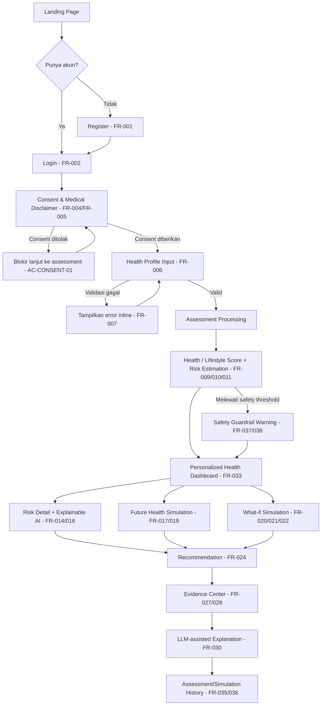

# HELIORA — UI/UX Design Document

## 0. Document Control

| Item | Keterangan |
|---|---|
| Nama Dokumen | HELIORA — UI/UX Design Document (`design.md`) |
| Turunan dari | HELIORA PRD v1.1 (Revised, 19 Agustus 2026) |
| Kedudukan Dokumen | Supporting Document — setara dengan "UI/UX Guideline" pada PRD §1.7 |
| Status | v1.0 — Final untuk dibagikan ke tim (poin di §14 Open Questions masih perlu keputusan tim sebelum implementasi) |
| Dibuat | 24 Agustus 2026 |

### 0.1 Kedudukan dalam Source of Truth Hierarchy

Mengikuti PRD §20.23, dokumen ini berada di level **Architecture/Design**, bukan di atas PRD:

```text
PRD (Requirements, Scope, Business Rules, Acceptance Criteria)
        │
        ▼
design.md  ← dokumen ini (Information Architecture, User Flow, Page Design)
        │
        ▼
Implementation (Frontend Next.js)
```

Artinya: dokumen ini **tidak boleh mengubah** scope, business rule, atau safety boundary yang sudah ditetapkan PRD. Jika ada perbedaan, PRD yang menang.

### 0.2 Cakupan & Batasan

- Dokumen ini menerjemahkan Chapter 3 (Product Overview), Chapter 6 (Scope), Chapter 7 (Persona), Chapter 8 (User Journey), Chapter 9 (Functional Requirements), dan Chapter 13 (NFR) PRD menjadi **information architecture, user flow rinci, dan spesifikasi halaman**.
- **Login/Sign In, Landing Page, Dashboard, dan halaman user** diturunkan langsung dari requirement PRD (FR/BR/AC direferensikan di tiap bagian).
- **Admin Panel tidak disebutkan sama sekali di PRD** (tidak ada satu pun mention "admin" di seluruh dokumen 20 bab). Bagian admin pada dokumen ini adalah **usulan tambahan** (lihat §11) yang perlu divalidasi PM/Solution Architect sebelum dianggap requirement resmi — bukan turunan langsung PRD.
- Palet warna & tipografi (§2) sudah didefinisikan sebagai keputusan tim (bukan lagi placeholder); spacing scale & komponen Figma detail masih menyusul di iterasi hi-fi. Dokumen ini tetap fokus ke **struktur, hierarki informasi, dan perilaku (behavior)** halaman, sesuai level "UI/UX Guideline" yang dimaksud PRD §1.7.

---

## 1. Prinsip Desain

Diturunkan langsung dari PRD §3.13 (User Experience Principle), §5.5 (Product Principles), §13.6–13.7 (Usability & Accessibility):

| # | Prinsip | Implikasi Desain |
|---|---|---|
| 1 | **Understand Before Acting** | Setiap layar hasil (risk, score) selalu menampilkan penjelasan sebelum CTA aksi ditampilkan. |
| 2 | **Explainable by Default** | Tidak ada angka mentah tanpa penjelasan bahasa natural di sebelahnya (lihat PRD §13.6.1 — dilarang menampilkan `Risk Score: 0.67342` telanjang). |
| 3 | **Preventive, Not Diagnostic** | Copy, warna, dan ikon tidak boleh terlihat seperti hasil lab/diagnosis medis. Disclaimer selalu visible di halaman hasil, simulasi, dan rekomendasi (FR-005). |
| 4 | **Evidence-Based** | Rekomendasi penting selalu punya tautan "Lihat Evidence" (BR-EVIDENCE-001). |
| 5 | **Actionable** | Insight harus berujung pada 1 tindakan konkret, bukan sekadar informasi. |
| 6 | **Simple / Non-Alarming** | Bahasa awam, bertahap (progressive disclosure), tidak menakut-nakuti meski risiko tinggi (FR-037: tidak boleh menyatakan pengguna "punya penyakit X"). |
| 7 | **User-Controlled Exploration** | What-if & Future Health Simulation harus terasa reversible dan aman untuk "dicoba-coba" (BR-SIM-007: no permanent mutation). |
| 8 | **Accessible** | Kontras cukup, status tidak hanya bergantung warna, label jelas pada elemen interaktif (PRD §13.7). |

---

## 2. Tema & Visual Language (Design Tokens)

> Palet warna & tipografi di bawah adalah keputusan tim (hijau, light+dark mode, geometric sans) yang sudah diterjemahkan jadi token konkret. Spacing scale & komponen Figma detail tetap menyusul di iterasi hi-fi.

### 2.1 Brand & Filosofi Warna

- **Warna utama: Hijau** — selaras prinsip "Preventive First" (PRD §5.5.1). Nuansa yang dipakai deliberately bukan hijau "steril rumah sakit", tapi hijau daun/forest yang lebih hangat, supaya tidak berkesan seperti aplikasi diagnosis klinis (selaras Prinsip #3 "Preventive, Not Diagnostic" di §1 dokumen ini).
- Hijau juga dipakai sebagai warna semantik **"Low Risk"** (§2.4) — ada overlap makna antara "warna brand" dan "status risiko rendah". Ini **sengaja dipertahankan**, bukan dianggap bug: secara naratif justru memperkuat citra "hijau = kondisi baik, preventive, aman". Mitigasinya: badge risiko selalu berbentuk **pill + ikon + label teks**, sehingga tidak pernah tertukar secara visual dengan tombol CTA brand.
- **Light + Dark Mode** didukung sejak MVP.
- **Tipografi:** geometric sans-serif — [Plus Jakarta Sans](https://fonts.google.com/specimen/Plus+Jakarta+Sans). Dipilih juga karena relevansi naratif (typeface ini didesain di Jakarta) untuk produk kompetisi asal Indonesia, gratis di Google Fonts, dukungan diakritik Latin lengkap, dan mudah diimplementasikan via `next/font/google` (selaras stack Next.js, PRD §12.3.1).

### 2.2 Palet Warna — Light Mode

**Primary (Hijau / Brand)**

| Token | Hex | Kegunaan | Kontras Terverifikasi |
|---|---|---|---|
| `primary-50` | `#F0FDF6` | Background section alt, hover subtle | — (bukan konteks teks) |
| `primary-100` | `#DCFCE9` | Background badge "Low risk", chip aktif | — |
| `primary-300` | `#86E8B0` | Border aktif, aksen ilustrasi | — |
| `primary-500` | `#22B573` | Ikon, brand mark — **jangan** dipakai sebagai teks di atas putih | ❌ 2.65:1 (gagal AA sbg teks) |
| `primary-700` | `#0F7A4E` | Tombol primer (bg + teks putih), link teks, teks badge "Low" di atas `primary-100` | ✅ AA — 5.37:1 (di atas putih) / 4.89:1 (di atas `primary-100`) |
| `primary-800` | `#0D5F3F` | Hover/active state tombol primer | ✅ AAA — 7.70:1 |

**Neutral**

| Token | Hex | Kegunaan | Kontras |
|---|---|---|---|
| `neutral-0` | `#FFFFFF` | Background utama | — |
| `neutral-50` | `#F7F9F8` | Background section alternate (warm, bukan abu netral) | — |
| `neutral-200` | `#DEE5E1` | Border / divider | — |
| `neutral-700` | `#3A423D` | Body text | ✅ AAA — 10.36:1 |
| `neutral-900` | `#14201A` | Heading | ✅ AAA — 16.78:1 |

**Semantic — Moderate (Amber) & Higher (Clay-Red)** — dipakai untuk badge risiko §2.4, warna merahnya sengaja dibuat hangat/muted, bukan merah alarm terang, selaras prinsip "Non-Alarming" (§1).

| Token | Hex | Kegunaan | Kontras |
|---|---|---|---|
| `amber-100` | `#FEF3D6` | Background badge "Moderate" | — |
| `amber-800` | `#92400E` | Teks badge "Moderate" (di atas `amber-100`) / tombol amber + teks putih | ✅ AA 6.42:1 (badge) · ✅ AAA 7.09:1 (tombol) |
| `red-100` | `#FBE3E0` | Background badge "Higher" | — |
| `red-600` | `#B8392E` | Tombol/ikon "Higher" (bg + teks putih) | ✅ AA — 5.73:1 |
| `red-700` | `#9A2E24` | Teks badge "Higher" (di atas `red-100`) | ✅ AA — 6.15:1 |

> Rasio kontras dihitung dengan formula relative luminance WCAG 2.1, bukan tebakan estetika — tetap wajib divalidasi ulang dengan contrast checker saat implementasi final di Tailwind config, terutama bila hue digeser demi preferensi visual di tahap hi-fi.

### 2.3 Palet Warna — Dark Mode

Bukan sekadar invert dari light mode — tone brand digeser lebih terang (`primary-400`, bukan `primary-700`) supaya tetap kontras di atas background gelap.

| Token | Hex | Kegunaan | Kontras (di atas `surface`) |
|---|---|---|---|
| `bg-base` (dark) | `#0E1512` | Background utama (hijau-hitam hangat, bukan hitam pekat) | — |
| `surface` (dark) | `#182620` | Card, panel | — |
| `surface-hover` (dark) | `#22332B` | Hover/active surface | — |
| `border` (dark) | `#2A3A32` | Divider | — |
| `text-primary` (dark) | `#EAF3EE` | Body text | ✅ AAA — 13.88:1 |
| `text-secondary` (dark) | `#A9B8B0` | Caption / secondary text | ✅ AAA — 7.61:1 |
| `primary-400` (dark) | `#4ED18C` | Brand accent, link, teks badge "Low" | ✅ AAA — 8.10:1 |
| `amber-400` (dark) | `#FBBF24` | Teks/badge "Moderate" | ✅ AAA — 9.41:1 |
| `red-400` (dark) | `#F2726B` | Teks/badge "Higher" | ✅ AA — 5.53:1 |

### 2.4 Semantik Warna Risiko

PRD §13.7 tetap berlaku: status risiko **tidak boleh bergantung warna saja** → setiap badge wajib kombinasi **warna + ikon + label teks**, di kedua mode.

| Level Risiko | Light Mode | Dark Mode | Ikon | Label Teks |
|---|---|---|---|---|
| Low | bg `primary-100` · teks `primary-700` | bg `surface` · teks `primary-400` | check-circle | "Lower" |
| Moderate | bg `amber-100` · teks `amber-800` | bg `surface` · teks `amber-400` | alert-triangle (outline) | "Moderate" |
| Higher | bg `red-100` · teks `red-700` | bg `surface` · teks `red-400` | alert-triangle (filled) | "Higher" |

Catatan: PRD §17.37A mewajibkan istilah **"estimated risk score"**, bukan "probability", selama model belum tervalidasi kalibrasinya — istilah ini yang dipakai di seluruh copy UI, bukan "Probability" atau "Chance".

### 2.5 Tipografi, Skor & Ikonografi

- **Font:** Plus Jakarta Sans untuk heading, body, dan UI label. Weight 400 (body) / 600 (label, tombol) / 700 (heading, angka skor besar) sudah cukup untuk MVP — hindari menambah family kedua supaya bundle size & waktu development tetap ringkas.
- Angka skor besar (Health Score, Lifestyle Score) memakai **tabular/lining figures** dari font yang sama, supaya digit sejajar rapi saat dua skor tampil berdampingan (lihat wireframe Dashboard §7.1).
- Skor tetap **tidak boleh berdiri sendiri** tanpa interpretasi teks (PRD §13.6.1 — prinsip ini sudah masuk §1 poin 2).
- Istilah teknis (SHAP, feature contribution, model version) tidak muncul di UI utama pengguna — hanya di Admin Panel / Evidence detail lanjutan.
- **Ikonografi:** outline/stroke icon minimalis agar senada dengan tipografi geometric — [Lucide](https://lucide.dev/) adalah kandidat yang cocok dan sudah tersedia sebagai library React (`lucide-react`).

### 2.6 Disclaimer Component

Karena FR-005 mewajibkan disclaimer muncul di 4 titik (onboarding, hasil assessment, simulation, recommendation), disclaimer harus jadi **1 komponen reusable** (bukan teks bebas per halaman) agar konsisten kata-per-kata dengan pesan resmi PRD §8.4:

> "HELIORA adalah alat bantu preventive health berbasis lifestyle dan AI. Hasil yang diberikan merupakan estimasi berdasarkan data dan model yang digunakan, bukan diagnosis medis dan bukan pengganti konsultasi dokter."

Disclaimer tampil di atas `neutral-50` (light) / `surface` (dark) dengan teks `neutral-700` / `text-secondary` — netral, tidak memakai warna semantik risiko apa pun, supaya tidak disalahartikan sebagai status. Disclaimer **selalu solid/opaque**, tidak pernah memakai material glass (lihat §2.7) — keterbacaan pesan keselamatan lebih penting daripada estetika.

### 2.7 Material — Glassmorphism (terinspirasi Apple HIG / Liquid Glass)

Sejak WWDC 2025, Apple HIG memformalkan material translucent bernama **Liquid Glass** di bagian *Materials* — dasar dari tren glassmorphism yang lebih luas. HELIORA mengadopsi prinsipnya secara selektif, bukan menerapkannya ke semua elemen:

- **Kaidah utama dari Apple (dipegang di HELIORA):** glass "best reserved for the navigation layer that floats above the content" — dipakai untuk elemen kontrol/navigasi yang mengambang di atas konten, **bukan** untuk konten itu sendiri. Apple juga eksplisit memperingatkan: jangan menumpuk lebih dari satu lapisan glass sekaligus (menyebabkan clutter, melemahkan hierarki).
- **Isu aksesibilitas yang diakui Apple sendiri:** komponen transparan di atas background kompleks bisa mengganggu keterbacaan. Rekomendasi mereka — kontras teks tetap ≥4.5:1 (WCAG) meski di atas material transparan, dan sistem harus menghormati preferensi pengguna *Reduce Transparency* (beralih ke solid).

**Dipakai di HELIORA (elemen chrome/navigasi):**
- Navbar sticky di Landing Page & top-nav aplikasi.
- Floating action card (2 tombol simulasi di Dashboard) saat di-scroll/sticky.
- Backdrop modal (Safety Guardrail, Risk Detail jika berbentuk modal).
- Floating tagline card di panel visual Login (§5.3).

**TIDAK dipakai (harus solid/opaque):**
- `ScoreCard`, `RiskBadge`, teks faktor kontribusi — data kesehatan wajib kontras penuh.
- `DisclaimerBanner` / Disclaimer Component (§2.6) — pesan keselamatan.
- Form input (Health Profile, Login, Register) — keterbacaan input lebih penting dari estetika.

**Token (light mode):** background putih 70% opacity + `backdrop-blur` 16–20px + border 1px putih ~40% opacity (kesan tepi kaca) + shadow halus.
**Token (dark mode):** background `surface` (`#182620`) ~55–65% opacity + `backdrop-blur` + border 1px putih ~8–12% opacity.
**Fallback wajib:** saat OS/browser mengaktifkan `prefers-reduced-transparency`, elemen glass beralih ke background solid (`neutral-0`/`surface`) tanpa blur — mengikuti pendekatan Apple sendiri, bukan preferensi HELIORA yang diabaikan begitu saja.

### 2.8 Referensi Komponen — shadcn/ui

[shadcn/ui](https://ui.shadcn.com/) dipakai sebagai acuan struktur komponen (bukan library wajib) karena dibangun di atas **React + Tailwind CSS + TypeScript** — identik dengan stack HELIORA (PRD §12.3) — dan ikon default-nya adalah **Lucide**, sama dengan rekomendasi §2.5. Tidak perlu rekonsiliasi tambahan.

- **Struktur Card acuan:** `Card` (border, `rounded-xl` ±12px, `shadow-sm` halus) → `CardHeader` (`CardTitle` + `CardDescription`) → `CardContent` → `CardFooter`. Dipakai sebagai bentuk dasar `ScoreCard`, `EvidenceCard`, dan container `RiskBadge` di §11 Component Library.
- **Token mapping:** token HELIORA (§2.2–2.3) dipetakan ke CSS variable bergaya shadcn — `--background`, `--foreground`, `--card`, `--card-foreground`, `--primary`, `--primary-foreground`, `--muted`, `--muted-foreground`, `--border`, `--radius: 0.75rem` — supaya komponen shadcn bisa dipakai langsung tanpa override berlebihan.
- **Varian "glass":** untuk elemen chrome di §2.7, `Card` shadcn di-override dengan `backdrop-blur` + background semi-transparan sesuai token di atas. Untuk konten data (skor, disclaimer), tetap pakai `Card` standar solid — **jangan** dijadikan glass.

---

## 3. Information Architecture (Sitemap)

```text
PUBLIC (unauthenticated)                         AUTHENTICATED (user)
├── / (Landing Page)                              ├── /onboarding/consent
├── /login (Sign In)                              ├── /onboarding/health-profile
├── /register (Sign Up)                           ├── /assessment/processing
├── /forgot-password  *usulan*                     ├── /dashboard  (home setelah login)
└── /evidence-preview *opsional, lihat §7.1*       ├── /risk/:diseaseId
                                                   ├── /simulation/future
                                                   ├── /simulation/what-if
                                                   ├── /recommendations
                                                   ├── /evidence  &  /evidence/:id
                                                   ├── /history (assessment + simulation)
                                                   ├── /account (profile, privacy, consent, logout)
                                                   └── /help (disclaimer & batasan produk)

ADMIN *usulan tambahan, lihat §11*
├── /admin/dashboard
├── /admin/users
├── /admin/knowledge-base (Evidence/RAG)
├── /admin/recommendation-rules
├── /admin/model-monitoring
└── /admin/audit-log
```

Sesuai BR-AUTH-001: user tidak login hanya boleh mengakses halaman di grup **PUBLIC**. Semua route di bawah `/dashboard` dst. wajib redirect ke `/login` jika belum autentikasi.

---

## 4. End-to-End User Flow (Detail)

Ini adalah versi rinci dari High-Level User Flow PRD §3.14, digabung dengan tahapan Chapter 8 (User Journey Stage 1–13). Ditambahkan decision point yang belum eksplisit di PRD (consent ditolak, validasi gagal, safety threshold).



### 4.1 Tabel Tahapan (referensi PRD Chapter 8)

| Tahap | Halaman | PRD Ref | Exit Criteria |
|---|---|---|---|
| Discovery | Landing Page | §8.3 | User paham value prop & klik CTA |
| Auth | Register/Login | §9.3 | Session terbentuk |
| Onboarding & Consent | Consent screen | §8.4, FR-004 | Consent = true |
| Health Profile Input | Multi-step form | §8.5, FR-006 | Semua required field valid |
| Health Assessment | Loading/processing | §8.6 | Score & risk tersedia |
| Dashboard | Dashboard | §8.7, FR-033 | User mengakses minimal 1 detail lanjutan |
| Risk Estimation & XAI | Risk Detail | §8.8–8.9, FR-014 | User memahami "mengapa" |
| Future Health Simulation | Simulation page | §8.10, FR-017 | User melihat proyeksi 30/90/180 hari |
| What-if Simulation | Simulation page | §8.11, FR-020 | User membandingkan current vs simulated |
| Recommendation | Recommendation page | §8.12, FR-024 | User melihat prioritas rekomendasi |
| Evidence Center | Evidence page | §8.13, FR-027 | User membuka minimal 1 sumber evidence |
| LLM Explanation | Panel penjelasan | §8.14, FR-030 | — |
| Safety Guardrail | Modal peringatan | §8.15, FR-037 | Muncul hanya jika threshold terlampaui |

---

## 5. Spesifikasi Halaman — Public

### 5.1 Landing Page (`/`)

PRD §8.3 hanya menyebut landing page harus menjelaskan: apa itu HELIORA, masalah yang diselesaikan, manfaat utama, konsep preventive health, Future Health Simulation, What-if Simulation, dan disclaimer medis. Struktur section berikut adalah **penjabaran** dari requirement tersebut mengikuti pola landing page SaaS yang umum (lihat §15 Referensi) — problem-first, bukan feature-first, karena audiens umumnya belum sadar (problem-aware) terhadap risiko lifestyle mereka.

```text
┌─────────────────────────────────────────────────────┐
│ NAVBAR: [HELIORA logo]     Fitur  Cara Kerja  FAQ    │
│                                   [Sign In] [Daftar] │
├─────────────────────────────────────────────────────┤
│ HERO                                                 │
│ "Predict Today. Prevent Tomorrow."                   │
│ Sub: Pahami risiko kesehatanmu dari gaya hidup —     │
│ sebelum jadi masalah.                                │
│ [Mulai Assessment Gratis]   [Lihat Cara Kerja]       │
├─────────────────────────────────────────────────────┤
│ PROBLEM SECTION                                      │
│ "Informasi kesehatan terlalu umum & sulit dipahami"  │
│ 3 pain point singkat (ref PRD §4.4)                  │
├─────────────────────────────────────────────────────┤
│ HOW IT WORKS — 5 Langkah                             │
│ Predict → Explain → Simulate → Recommend → Educate   │
│ (ref PRD §2.2 / §5.4)                                │
├─────────────────────────────────────────────────────┤
│ KILLER FEATURES (highlight 2 fitur utama)            │
│ ┌───────────────────┐  ┌───────────────────┐        │
│ │ Future Health      │  │ What-if Simulation │        │
│ │ Simulation          │  │                    │        │
│ │ "Lihat proyeksi     │  │ "Coba ubah tidur,  │        │
│ │  30/90/180 hari"     │  │  aktivitas, berat  │        │
│ │                      │  │  badan — lihat     │        │
│ │                      │  │  dampaknya"        │        │
│ └───────────────────┘  └───────────────────┘        │
├─────────────────────────────────────────────────────┤
│ TRUST / EVIDENCE STRIP                               │
│ "Didukung sumber terpercaya:"                        │
│ WHO · Kemenkes RI · PERKENI · PERKI · CDC             │
├─────────────────────────────────────────────────────┤
│ MEDICAL DISCLAIMER BANNER (persistent, tidak dismiss) │
│ Teks resmi FR-005 (lihat §2.6)                        │
├─────────────────────────────────────────────────────┤
│ FAQ (opsional P2) — "Apakah ini diagnosis medis?"     │
├─────────────────────────────────────────────────────┤
│ FOOTER: About · Privacy · Disclaimer · Contact        │
└─────────────────────────────────────────────────────┘
```

**Catatan desain:**
- Satu CTA primer saja di hero ("Mulai Assessment Gratis") — CTA sekunder ("Lihat Cara Kerja") hanya scroll-anchor, bukan kompetisi perhatian.
- Disclaimer harus **selalu terlihat sebelum user meninggalkan landing page**, sesuai batasan produk PRD §20.21 yang berlaku juga di "marketing statement" — cukup lewat **MEDICAL DISCLAIMER BANNER** di bawah (satu elemen persistent), tanpa perlu badge/chip tambahan di hero yang membuat hero terasa ramai.
- Tidak ada elemen visual yang menyerupai hasil lab/diagnosis (hindari ikon stetoskop, salib medis, dsb.) — selaras §3.19 Medical Safety Boundary.

### 5.2 Register (`/register`) — FR-001

| Field | Validasi |
|---|---|
| Nama | required |
| Email | required, unik |
| Password | required, hashed di backend (BR-AUTH-002) |
| Konfirmasi Password | harus sama dengan Password |

- Setelah submit sukses → redirect ke `/login` (sesuai FR-001 output: "berhasil memiliki akun dan dapat login") atau auto-login langsung ke `/onboarding/consent` — **keputusan desain untuk didiskusikan tim** (PRD tidak menspesifikasikan mana yang dipakai).
- Link "Sudah punya akun? Sign In" di bawah form.

### 5.3 Login / Sign In (`/login`) — FR-002

Layout **split-screen 2 section** — kolom kiri berisi form, kolom kanan panel visual brand:

```text
┌───────────────────────┬───────────────────────────────┐
│ ← Kembali ke Beranda    │                                 │
│ [HELIORA logo]          │                                 │
│                          │                                 │
│ Masuk ke akun kamu       │     Panel visual — foto/ilustrasi │
│ Silakan login untuk      │     nature/wellness (hijau,       │
│ melanjutkan              │     organik), dimasking bentuk     │
│                          │     rounded/blob — BUKAN foto      │
│ ┌───────────────────────┐│    medis (stetoskop, dsb.)        │
│ │ Email    [__________] ││                                 │
│ │ Password [__________] ││    ┌─────────────────────┐     │
│ └───────────────────────┘│    │ "Predict Today.       │     │
│  card, border + shadow   │    │  Prevent Tomorrow."    │     │
│  tipis (shadcn-style)     │    └─────────────────────┘     │
│          Lupa password?  │        floating card — glass      │
│ ☐ Ingat saya  *usulan     │        (§2.7, blur+translucent)   │
│                          │                                 │
│ [ Sign In ] [ Daftar ]   │                                 │
│  (solid)     (outline)   │                        (●) ← toggle │
│                          │                          light/dark │
│ ⚠ Dengan masuk, kamu       │                                 │
│ menyetujui HELIORA tidak  │                                 │
│ menggantikan diagnosis    │                                 │
│ medis.                    │                                 │
└───────────────────────┴───────────────────────────────┘
   Kolom kiri ~40–45% lebar        Kolom kanan ~55–60% lebar
```

- Kolom kanan **disembunyikan** di breakpoint mobile — form kolom kiri jadi full-width, sesuai prinsip mobile-first §9.
- **"Kembali ke Beranda"** — tombol ghost/text kecil di pojok kiri atas, di atas logo, mengarah ke `/` (Landing Page). Styling sekunder (teks muted, ikon panah kiri), tidak boleh bersaing visual dengan tombol "Sign In".
- **Field Email + Password dibungkus 1 card** — border tipis + shadow halus (acuan `Card` shadcn/ui §2.8: `rounded-xl`, `border`, `shadow-sm`), supaya form terpisah jelas dari background putih polos, bukan sekadar input mengambang. Heading & subtext tetap di luar card, di atasnya.
- "Ingat saya" ditandai usulan seperti "Lupa password?" — FR-002 hanya menyebut Email + Password sebagai input, checkbox ini bukan requirement resmi PRD.
- Tombol "Daftar" dijadikan tombol outline bersebelahan dengan "Sign In" (bukan sekadar link teks) — lebih discoverable, tanpa mengubah makna FR-002.
- Floating card tagline & toggle light/dark di kolom kanan murni elemen brand/dekoratif, tidak mengandung data pengguna.
- Setelah autentikasi sukses → redirect ke `/dashboard` (FR-002 output eksplisit: "diarahkan ke dashboard HELIORA").
- Jika user belum pernah menyelesaikan Health Profile, `/dashboard` harus redirect otomatis ke `/onboarding/consent` (bukan menampilkan dashboard kosong) — flow ini tidak eksplisit di PRD, diusulkan agar user baru tidak "nyasar" di dashboard tanpa data.
- Error autentikasi: pesan generik ("Email atau password salah") — jangan spesifik "email tidak ditemukan" (mencegah user enumeration, selaras BR-AUTH security-first).

### 5.4 Forgot Password (`/forgot-password`) — *usulan, tidak ada di PRD*

PRD tidak mendefinisikan reset password (hanya FR-001 Register, FR-002 Login, FR-003 Logout). Halaman ini diusulkan sebagai kebutuhan dasar SaaS auth standar; sifatnya **bukan requirement resmi** — perlu ditambahkan ke FR jika disetujui tim (misal FR-001A).

---

## 6. Spesifikasi Halaman — Onboarding

### 6.1 Consent & Medical Disclaimer (`/onboarding/consent`) — FR-004, FR-005, BR-CONSENT-001/002

```text
┌─────────────────────────────────────────────┐
│ Sebelum memulai...                            │
│                                               │
│ HELIORA akan menggunakan data lifestyle-mu    │
│ untuk:                                        │
│  • Estimasi risiko kesehatan                  │
│  • Health & Lifestyle Score                   │
│  • Simulasi (Future Health & What-if)         │
│  • Rekomendasi preventif                      │
│                                               │
│ ⚠ Disclaimer Medis                            │
│ [teks resmi FR-005, lihat §2.6]               │
│                                               │
│ ☐ Saya memahami dan menyetujui penggunaan     │
│    data sesuai penjelasan di atas             │
│                                               │
│        [Lanjut ke Health Profile]  (disabled  │
│         sampai checkbox dicentang)            │
└─────────────────────────────────────────────┘
```

- Tombol lanjut **disabled** sampai consent dicentang — implementasi langsung dari AC-CONSENT-01 ("Pengguna tidak dapat melanjutkan ke health assessment sebelum memberikan consent").
- Consent yang diberikan harus tercatat (FR-039 Consent Recording) dan dapat dicabut kembali lewat `/account` (BR-CONSENT-003).

### 6.2 Health Profile Input (`/onboarding/health-profile`) — FR-006/007/008

Form **multi-step** (bukan 1 form panjang), sesuai UX Principle PRD §8.5 ("menghindari form yang terlalu panjang"):

```text
Step 1/3 — Data Dasar          Step 2/3 — Lifestyle         Step 3/3 — Riwayat (opsional)
Age, Gender                    Physical Activity            Family History
Height, Weight (→ live BMI)    Sleep Duration                Stress Level*
                                Smoking Status                Waist Circumference*
                                                              Blood Pressure*
                                                              Blood Sugar*, Cholesterol*
                                                              (* skip tersedia — FR ini optional,
                                                               tidak boleh jadi dependency utama MVP)
```

- Progress indicator step 1/2/3 di atas form.
- BMI dihitung **live** saat height/weight diisi, ditampilkan sebagai info pendukung — bukan sebagai skor tunggal (FR-008: "BMI tidak boleh ditampilkan sebagai diagnosis penyakit").
- Validasi inline per field sesuai FR-007 (contoh: age harus dalam rentang valid, height/weight > 0). Pesan error muncul di bawah field saat blur, bukan hanya saat submit.
- Step 3 (optional data) punya tombol "Lewati" yang jelas terlihat, tidak disamarkan — supaya user tidak merasa wajib mengisi data sensitif tambahan (selaras BR-PRIVACY-001 Data Minimization).

### 6.3 Assessment Processing (`/assessment/processing`)

Halaman transisi singkat saat pipeline berjalan (§8.6: Data Validation → Feature Engineering → Risk Engine → Score).

```text
┌───────────────────────────┐
│   Menganalisis profil-mu   │
│         [spinner]           │
│  "Menghitung estimasi       │
│   risiko berbasis lifestyle │
│   kamu..."                  │
└───────────────────────────┘
```

- Jika AI service gagal (FR-042), tampilkan pesan fallback yang jelas + opsi retry — lihat §10 Error States. Tidak boleh hang tanpa feedback.

---

## 7. Spesifikasi Halaman — Core (Authenticated User)

### 7.1 Personalized Health Dashboard (`/dashboard`) — FR-033, FR-034

Ini adalah pengembangan langsung dari Conceptual Layout PRD §8.7, dipecah jadi grid card agar lebih scannable:

```text
┌───────────────────────────────────────────────────────┐
│  Halo, {Nama}         Assessment terakhir: {tanggal}    │
├───────────────────────────────────────────────────────┤
│ ┌───────────────┐ ┌───────────────┐                    │
│ │ Health Score   │ │ Lifestyle Score│                    │
│ │      78        │ │       72       │                    │
│ └───────────────┘ └───────────────┘                    │
├───────────────────────────────────────────────────────┤
│ Estimated Health Risk                                   │
│ ┌─────────────────────────────────────────────────┐    │
│ │ Diabetes         🟡 Moderate        [Detail →]    │    │
│ │ Hypertension     🟢 Lower           [Detail →]    │    │
│ │ Cardiovascular   🟡 Moderate        [Detail →]    │    │
│ └─────────────────────────────────────────────────┘    │
├───────────────────────────────────────────────────────┤
│ Top Contributing Factors        Recommended Actions      │
│ • Aktivitas fisik rendah        1. Tingkatkan aktivitas  │
│ • Durasi tidur kurang           2. Perbaiki durasi tidur │
│ • BMI di atas target            [Lihat semua →]          │
├───────────────────────────────────────────────────────┤
│ [🔮 Future Health Simulation]  [🎛 What-if Simulation]   │
├───────────────────────────────────────────────────────┤
│ ⚠ HELIORA bukan alat diagnosis medis. [selengkapnya]     │
└───────────────────────────────────────────────────────┘
```

- Dashboard **tidak boleh** menampilkan raw model output (selaras §6.15: "mengutamakan readability, tidak terlalu banyak informasi teknis").
- Card risiko per penyakit adalah entry point ke Risk Detail (`/risk/:diseaseId`).
- Dua tombol simulasi ditempatkan menonjol karena keduanya **killer feature** produk (PRD §2.9) — bukan disembunyikan di menu.

### 7.2 Risk Detail (`/risk/:diseaseId`) — §6.16, FR-014/015/016

Bisa berupa halaman penuh atau modal (PRD memberi kebebasan: "Halaman atau modal detail").

```text
┌─────────────────────────────────────────┐
│ ← Kembali ke Dashboard                    │
│                                           │
│ Diabetes Risk — 🟡 Moderate               │
│                                           │
│ Mengapa hasil ini muncul?                 │
│ ┌───────────────────────────────────┐    │
│ │ Aktivitas fisik rendah    ▓▓▓▓▓░░░ │    │  ← feature contribution bar (FR-015)
│ │ Durasi tidur kurang        ▓▓▓▓░░░ │    │
│ │ BMI di atas target         ▓▓▓░░░░ │    │
│ └───────────────────────────────────┘    │
│                                           │
│ [Lihat rekomendasi terkait]               │
│ [Lihat evidence]                          │
│                                           │
│ ⚠ Disclaimer medis (komponen reusable)    │
└─────────────────────────────────────────┘
```

- Visualisasi kontribusi faktor menggunakan **bar chart horizontal sederhana** dengan label bahasa natural, bukan grafik SHAP mentah (PRD §13.6.2: SHAP jadi *metode di balik layar*, bukan tampilan literal ke user awam).

### 7.3 Future Health Simulation (`/simulation/future`) — §8.10, FR-017/018/019

```text
┌─────────────────────────────────────────────┐
│ Future Health Simulation                      │
│ "Proyeksi berdasarkan kebiasaan kamu saat ini"│
│                                               │
│ Lifestyle Score saat ini: 68                  │
│                                               │
│   30 hari      90 hari      180 hari          │
│     70            73            76            │
│   [●───────●───────●──────────────────]       │  ← timeline horizon selector
│                                               │
│ ℹ Ini adalah proyeksi berbasis model,          │
│   bukan prediksi medis yang pasti.            │
│                                               │
│ [Coba ubah gaya hidup → What-if Simulation]   │
└─────────────────────────────────────────────┘
```

- Horizon 30/90/180 hari sesuai §8.10 — ditampilkan sebagai **satu garis proyeksi**, bukan grafik kompleks, agar tetap mudah dipahami pengguna non-teknis.
- CTA di bawah mengarahkan ke What-if Simulation — dua fitur ini secara sengaja dihubungkan sebagai satu alur eksplorasi (selaras Demo Scenario PRD §20.19 Step 4→5).

### 7.4 What-if Simulation (`/simulation/what-if`) — §8.11, FR-020/021/022/023

```text
┌─────────────────────────────────────────────────┐
│ What-if Simulation                                │
│                                                   │
│ Sleep Duration      [────●──────] 5.5 → 7.5 jam   │
│ Physical Activity    [──●────────] 60 → 150 min/mgg│
│ Weight                [────●─────] 82 → 78 kg      │
│                                                   │
│ ┌─────────────────┐   ┌─────────────────┐         │
│ │ Current           │   │ Simulated         │         │
│ │ 🟡 Moderate        │ → │ 🟢 Lower           │         │
│ └─────────────────┘   └─────────────────┘         │
│                                                   │
│         Perubahan: ↓ 12%                          │
│  (hasil simulasi model, bukan jaminan medis)      │
│                                                   │
│ [Reset ke Current]      [Simpan skenario ini]     │
└─────────────────────────────────────────────────┘
```

- 3 slider sesuai parameter prioritas MVP (sleep, physical activity, weight — §8.11).
- **Real-time recalculation**: setiap slider digerakkan → panel "Simulated" update langsung (FR-021), tanpa perlu klik submit. Target performa mengacu NFR §13.2.2.
- Kombinasi **slider + nilai numerik** ditampilkan berdampingan (bukan slider polos) agar user tetap tahu angka pasti yang sedang dicoba — pola umum untuk slider eksploratif (lihat referensi §15).
- Tombol "Reset ke Current" wajib ada dan jelas — menegaskan sifat *exploratory, reversible* dari simulasi (BR-SIM-007/008: no permanent mutation, simulation reset).
- Panel Current vs Simulated **berdampingan**, bukan bergantian tab, supaya perbandingan langsung terlihat tanpa toggle.

### 7.5 Recommendation (`/recommendations`) — §8.12, FR-024/025/026

```text
┌─────────────────────────────────────────┐
│ Rekomendasi untuk Kamu                    │
│                                           │
│ 🔴 Prioritas Tinggi                       │
│  Tingkatkan aktivitas fisik               │
│  → Target: 150 menit/minggu               │
│  [Lihat evidence]                         │
│                                           │
│ 🟡 Prioritas Sedang                       │
│  Perbaiki durasi tidur ke 7–9 jam         │
│  [Lihat evidence]                         │
│                                           │
│ ⚪ Prioritas Rendah                        │
│  Pertahankan kebiasaan tidak merokok       │
└─────────────────────────────────────────┘
```

- Urutan berdasarkan prioritas (BR-REC-002), bukan urutan kronologis.
- Setiap item wajib punya tautan evidence bila didukung evidence (FR-028) — tidak semua rekomendasi wajib evidence, tapi yang tampil harus jujur soal ada/tidaknya dasar evidence (BR-EVIDENCE-005 Transparency).

### 7.6 Evidence Center (`/evidence`, `/evidence/:id`) — §8.13, FR-027/028/029

```text
List (/evidence)                       Detail (/evidence/:id)
┌─────────────────────────┐            ┌─────────────────────────┐
│ Evidence Center            │            │ ← Kembali                │
│                             │            │                          │
│ 🔍 [cari topik...]          │            │ WHO Physical Activity     │
│                             │            │ Guidelines                │
│ • WHO Physical Activity     │   klik →   │                          │
│   Guidelines    [Strong]    │            │ Organisasi: WHO           │
│ • Sleep & Metabolic Health  │            │ Tahun: 2020                │
│   [Moderate]                │            │ Ringkasan: ...             │
│ • Smoking Cessation Support │            │ Bagian relevan: ...        │
│   [Strong]                  │            │                          │
└─────────────────────────┘            └─────────────────────────┘
```

- Badge kekuatan evidence (Strong/Moderate) ditampilkan di list agar user bisa menilai bobot tanpa perlu buka detail.
- Detail menampilkan metadata lengkap sesuai FR-029: sumber, judul, organisasi, tahun, bagian relevan, ringkasan.

### 7.7 LLM-assisted Explanation — §8.14, FR-030/031/032

Bukan halaman terpisah — **panel penjelasan** yang muncul kontekstual di Risk Detail, Recommendation, dan Evidence Detail (karena FR-031 menegaskan LLM hanya explanation layer, bukan destinasi utama):

```text
┌─────────────────────────────────────┐
│ 💬 Penjelasan                         │
│ "Risiko diabetes kamu tergolong        │
│  moderate, terutama karena aktivitas   │
│  fisik yang masih rendah dan durasi    │
│  tidur yang kurang dari anjuran.       │
│  Menurut WHO Physical Activity         │
│  Guidelines, aktivitas rutin dapat     │
│  membantu menurunkan risiko ini."      │
└─────────────────────────────────────┘
```

- Selalu diletakkan **setelah** data terstruktur (score/badge/factor list) tampil, bukan sebagai chat kosong yang user harus tanya duluan — sesuai posisi LLM sebagai explanation layer terakhir dalam pipeline (§9.13).
- Jika RAG/LLM gagal (FR-043), panel ini digantikan fallback teks statis dari rule engine — lihat §10.

### 7.8 Safety Guardrail Modal — §8.15, FR-037/038

Muncul sebagai **modal interupsi** (bukan banner kecil) saat risk melewati threshold, karena ini life-relevant information:

```text
┌───────────────────────────────────────┐
│  ⚠ Perhatian                            │
│                                         │
│  Estimasi risikomu tergolong relatif    │
│  tinggi berdasarkan data yang           │
│  diberikan.                             │
│                                         │
│  Pertimbangkan untuk mendiskusikan      │
│  kondisi kesehatanmu dengan tenaga      │
│  kesehatan profesional.                 │
│                                         │
│           [Saya Mengerti]               │
└───────────────────────────────────────┘
```

- Copy **persis** dari FR-037 — tidak boleh direparafrase jadi menyebut nama penyakit tertentu ("kamu mungkin diabetes") sesuai larangan eksplisit FR-038.
- Modal tidak boleh punya CTA "Hubungi Dokter Sekarang" yang menyerupai fitur telemedicine — HELIORA eksplisit **bukan** aplikasi telemedicine (§1.5).

### 7.9 Assessment & Simulation History (`/history`) — FR-035/036

```text
Tab: [Assessment History]  [Simulation History]

Assessment History                    Simulation History
┌───────────────────────────┐        ┌───────────────────────────┐
│ 20 Agu 2026                 │        │ Skenario: Sleep 7j,        │
│ Health 78 · Lifestyle 72     │        │ Activity Moderate,          │
│ [Lihat detail]               │        │ Weight 75kg                 │
│                              │        │ Hasil: Lower vs baseline     │
│ 15 Jul 2026                  │        │ [Muat ulang skenario]        │
│ Health 74 · Lifestyle 68     │        └───────────────────────────┘
└───────────────────────────┘
```

- Simulation History adalah **Could Have** (FR-036, prioritas rendah) — boleh masuk fase belakangan roadmap tanpa mengganggu core MVP.

### 7.10 Account & Privacy (`/account`) — FR-039/040, BR-CONSENT-003

```text
Profil          Privacy & Consent              Keamanan
Nama, Email      Status consent: Diberikan       Ganti Password
                 [Cabut Consent]                  [Logout]
                 [Unduh data saya]  *usulan
                 [Hapus akun]        *usulan
```

- "Cabut Consent" wajib ada sesuai BR-CONSENT-003 — setelah dicabut, dashboard menampilkan state "data analysis dihentikan" (bukan error), dan mengarahkan user untuk consent ulang bila ingin lanjut.
- "Unduh data saya" & "Hapus akun" ditandai usulan karena PRD §7 (Data Retention) menyinggung **account deletion** sebagai bagian revisi v1.1 (§1.9.1) tapi tidak merinci UI-nya — perlu dikonfirmasi ke FR terkait sebelum difinalkan.

---

## 8. Error, Empty & Fallback States

Diturunkan dari FR-041/042/043 (Error Handling) dan §13.3.2 (Graceful Degradation):

| Situasi | PRD Ref | Perilaku UI |
|---|---|---|
| Input tidak valid | FR-041 | Pesan error inline di field terkait, tidak generic alert |
| Model/Risk Engine gagal | FR-042 | Tampilkan pesan "Analisis sedang tidak tersedia, coba lagi" + retry, jangan tampilkan skor palsu |
| RAG/LLM gagal | FR-043 | Sembunyikan panel LLM Explanation, tampilkan penjelasan fallback dari Rule Engine (bukan kosong) |
| Belum ada assessment | — | Dashboard kosong menampilkan CTA "Mulai Health Assessment", bukan tabel kosong |
| Consent dicabut | BR-CONSENT-003 | Dashboard menampilkan state netral: "Analisis dihentikan sesuai permintaanmu" + tombol consent ulang |

---

## 9. Responsive & Accessibility Notes

Berdasarkan PRD §13.7 (Accessibility) dan §A10 (sistem berbasis web):

- **Mobile-first**: karena target primary persona (§7.3) adalah masyarakat umum, bukan hanya pengguna desktop.
- Kontras teks/background memenuhi minimal WCAG AA untuk semua badge risiko (bukan hanya warna terang di atas warna terang).
- Semua elemen interaktif (slider, tombol, checkbox consent) punya label teks eksplisit, bukan hanya ikon.
- Slider What-if Simulation harus bisa dioperasikan lewat keyboard (arrow key) selain drag — penting untuk aksesibilitas dan konsistensi lintas device (lihat referensi slider §15).
- Status penting (safety warning, error) selalu punya indikator **teks + ikon**, tidak hanya warna (§13.7).

---

## 10. Admin Panel (Usulan Tambahan — Tidak Ada di PRD)

> ⚠️ **Penting:** Tidak ada satu pun mention "admin" di 20 bab PRD ini. Bagian ini murni usulan berdasarkan kebutuhan operasional yang biasanya muncul untuk platform dengan RAG Knowledge Base, Rule Engine, dan multiple user — **wajib divalidasi dan disetujui PM/Solution Architect**, idealnya dituliskan balik sebagai FR-XXX baru di PRD sebelum dikerjakan tim frontend/backend.

### 10.1 Rasionalisasi Kebutuhan

PRD menyebut beberapa komponen yang **butuh dikelola manusia** meski tidak eksplisit menyebut siapa yang mengelola:

| Komponen PRD | Kebutuhan Pengelolaan | PRD Ref |
|---|---|---|
| RAG Knowledge Base | Menambah/memvalidasi dokumen sumber (WHO, Kemenkes, dsb.) | §6.14, FR-027 |
| Recommendation Rule Engine | Melihat/mengubah rule (IF-THEN) tanpa redeploy | §14.13 |
| Model versioning | Memantau versi model aktif (BR-SCORE-008) | §14.20 |
| Auditability | Traceability model, recommendation, LLM | §14.28, BR-AUDIT-001-003 |
| Model Calibration Risk | Evaluasi kalibrasi output risiko | §17.37A |

### 10.2 Admin Sitemap (usulan)

```text
/admin/dashboard          — ringkasan sistem (uptime, jumlah user, model aktif)
/admin/users              — daftar user, status akun (bukan data health detail user!)
/admin/knowledge-base     — CRUD dokumen Evidence/RAG + metadata
/admin/recommendation-rules — daftar rule IF-THEN, read-only atau editable terbatas
/admin/model-monitoring   — versi model aktif, tanggal evaluasi, status kalibrasi
/admin/audit-log          — log traceability model/recommendation/LLM
```

### 10.3 Prinsip Batasan Admin (agar tetap konsisten dengan PRD)

- **Admin TIDAK boleh melihat detail health profile personal user** (nama penyakit, angka BMI personal, dsb.) tanpa dasar yang jelas — ini konsisten dengan BR-PRIVACY-002 ("data personal tidak boleh ditampilkan kepada pengguna lain", yang secara prinsip juga berlaku ke role internal, bukan hanya sesama user).
- Admin **hanya** mengelola konten sistem (knowledge base, rule, model monitoring) dan akun (aktif/nonaktif), bukan mengubah hasil analisis individual — supaya tidak melanggar BR-RISK-006/007 (Preventive Lifestyle Risk Engine sebagai satu-satunya sumber estimasi, deterministic).
- Role admin ini **belum punya definisi resmi** di PRD (siapa yang menjadi admin: tim dev sendiri via internal tool, atau role terpisah) — perlu diputuskan tim sebelum masuk FR resmi.

### 10.4 Wireframe Ringkas — Admin Dashboard

```text
┌───────────────────────────────────────────┐
│ HELIORA Admin                                │
├───────────────────────────────────────────┤
│ Total User: 1,204     Model Aktif: v1.3      │
│ Assessment Hari Ini: 87   Status RAG: OK      │
├───────────────────────────────────────────┤
│ ⚠ Model Calibration: Belum tervalidasi        │
│   (istilah "estimated risk score" masih       │
│    digunakan sesuai §17.37A)                  │
├───────────────────────────────────────────┤
│ [Kelola Knowledge Base] [Kelola Rules]        │
│ [Lihat Audit Log]                             │
└───────────────────────────────────────────┘
```

---

## 11. Component Library (Referensi Awal)

Struktur dasar mengacu `Card` shadcn/ui (§2.8): `CardHeader` → `CardContent` → `CardFooter`. Kolom **Material** menandai apakah komponen boleh pakai varian glass (§2.7) atau wajib solid.

| Komponen | Dipakai di | Material | Catatan |
|---|---|---|---|
| `ScoreCard` | Dashboard | Solid | Angka besar + label interpretasi, tidak berdiri sendiri |
| `RiskBadge` | Dashboard, Risk Detail | Solid | Warna + ikon + teks, token warna di §2.4 |
| `FactorContributionBar` | Risk Detail | Solid | Bahasa natural, bukan nilai SHAP mentah |
| `EvidenceCard` | Recommendation, Evidence Center | Solid | Badge kekuatan evidence |
| `SimulationSlider` | What-if Simulation | Solid | Slider + nilai numerik, keyboard-accessible |
| `ComparisonPanel` | What-if Simulation | Solid | Current vs Simulated berdampingan |
| `DisclaimerBanner` | Reusable di 4+ halaman | Solid (wajib) | Teks resmi FR-005, tidak boleh diubah bebas |
| `SafetyModal` | Safety Guardrail | Solid (wajib) | Interupsi penuh, bukan toast kecil |
| `ExplanationPanel` | Risk Detail, Recommendation | Solid | LLM output, dengan fallback state |
| `TopNav` / Sticky Navbar | Landing Page, App shell | Glass | Backdrop-blur, fallback solid jika `prefers-reduced-transparency` |
| `FloatingSimulationCTA` | Dashboard (sticky) | Glass | 2 tombol simulasi, mengambang saat scroll |

---

## 12. Design–Requirement Traceability (ringkas)

| Halaman | FR/BR/AC Terkait |
|---|---|
| Landing Page | §8.3 (Discovery), §20.21 |
| Login/Register | FR-001, FR-002, BR-AUTH-001–005 |
| Consent | FR-004, BR-CONSENT-001–003, AC-CONSENT-01 |
| Health Profile | FR-006, FR-007, FR-008, BR-PROFILE-001–006 |
| Dashboard | FR-033, FR-034, AC-DASH-01/02 |
| Risk Detail | FR-014, FR-015, FR-016, AC-XAI-01/02 |
| Future Health Simulation | FR-017–019, BR-SIM-001–004, AC-SIM-01/02 |
| What-if Simulation | FR-020–023, BR-WHATIF-001–006, AC-WHATIF-01/02 |
| Recommendation | FR-024–026, BR-REC-001–007, AC-REC-01/02 |
| Evidence Center | FR-027–029, BR-EVIDENCE-001–005, AC-EVIDENCE-01/02 |
| LLM Explanation | FR-030–032, BR-LLM-000–005, AC-LLM-01/02 |
| Safety Guardrail | FR-037, FR-038, BR-SAFETY-001–004, AC-SAFETY-01/02 |
| History | FR-035, FR-036 |
| Account/Privacy | FR-039, FR-040, BR-CONSENT-003 |
| Admin Panel | *tidak ada* — usulan, lihat §10 |

---

## 13. Referensi & Inspirasi Desain

Referensi berikut bersifat **pola/prinsip umum**, bukan untuk ditiru literal (menghindari duplikasi visual produk lain), dipakai sebagai bahan diskusi arah desain tim:

**Dashboard risiko & healthcare (pola kartu skor, badge risiko, panel explainability):**
- Kumpulan contoh "Health Score" & "Risk Dashboard" — https://dribbble.com/search/health-score dan https://dribbble.com/search/risk-dashboard
- Koru UX — praktik desain dashboard healthcare (confidence score, multi-modal visualization) — https://www.koruux.com/50-examples-of-healthcare-UI/

**Explainable AI (XAI) UI — prinsip bahasa natural untuk hasil model:**
- Eleken — prinsip UI untuk XAI: penjelasan harus pakai bahasa pengguna, bukan istilah model — https://www.eleken.co/blog-posts/explainable-ai-ui-design-xai

**Pola slider interaktif (untuk What-if Simulation):**
- Eleken — contoh nyata slider dengan live feedback dan kombinasi nilai visual+numerik — https://www.eleken.co/blog-posts/slider-ui
- Justinmind — kapan & bagaimana slider tepat dipakai untuk eksplorasi nilai — https://medium.com/@justinmind/slider-design-ui-patterns-and-examples-d01cbefe8c94

**Struktur landing page SaaS (hero problem-first, satu CTA primer, trust strip):**
- Ringkasan pola landing page SaaS 2026 (hero, problem-agitation-solution, social proof) — https://pineable.com/blog/saas-landing-page-design

> Catatan hak cipta: tautan di atas untuk inspirasi pola/struktur, bukan aset untuk disalin langsung. Desain visual final (warna, ilustrasi, tipografi) harus orisinal milik tim HELIORA.

---

## 14. Open Questions untuk Tim

Hal-hal yang **tidak dijawab eksplisit oleh PRD** dan perlu keputusan sebelum hi-fi design:

1. Setelah Register sukses — auto-login langsung ke consent, atau kembali ke halaman Login? (§5.2)
2. Apakah Forgot Password masuk MVP atau P1/P2? (§5.4 — tidak ada di PRD sama sekali)
3. Siapa yang berperan sebagai "admin" — role terpisah dengan login sendiri, atau internal tool khusus tim dev? (§10.3)
4. Risk Detail: halaman penuh atau modal? PRD memberi kebebasan ("halaman atau modal") — perlu keputusan final untuk konsistensi navigasi (§7.2).
5. "Unduh data saya" / "Hapus akun" di Account — apakah masuk scope MVP mengingat PRD v1.1 menyinggung *account deletion* di revision notes (§1.9.1) tapi belum ada FR eksplisit? (§7.10)

---

## 15. Prompt Stitch (AI Visual Generation Reference)

Prompt siap-paste untuk [Google Stitch](https://stitch.withgoogle.com/) (Web platform, mode Standard) — sudah final, menggabungkan seluruh keputusan desain di §2 (warna, tipografi, material glass, acuan shadcn/ui) dan revisi Login (back button + field dalam card berbayang). Ditulis dalam Bahasa Inggris karena Stitch memberi hasil paling konsisten dengan input Inggris.

**Cara pakai:** pilih platform **Web**, mode **Standard** (bisa export ke Figma). Paste satu prompt per generate. Kalau tersedia fitur setup design system/DESIGN.md di akun Stitch kamu, paste §2 (Tema & Visual Language) ke situ dulu supaya warna & font konsisten lintas layar.

### 15.1 Landing Page

```
Design a responsive web landing page for HELIORA, an AI-powered preventive
health platform (not a diagnostic or telemedicine app) for the Indonesian
general public — non-medical adults who want to understand personal health
risk from lifestyle habits and explore what-if scenarios.

Visual style: calm, trustworthy, preventive-health mood — warm and modern,
NOT a sterile clinical/hospital look. No stethoscope, cross, or medical-lab
imagery.
Primary color: forest green #0F7A4E (buttons, links), soft tint #DCFCE9,
accent #22B573. Neutrals: background #FFFFFF / #F7F9F8, body text #3A423D,
headings #14201A. Font: Plus Jakarta Sans (geometric sans-serif).
Cards styled like shadcn/ui: rounded-xl corners (~12px), thin border, soft
shadow-sm, generous internal padding. Icons in the style of Lucide (thin
outline/stroke icons).
Do NOT use any pill-shaped chip/badge anywhere on this page.

Layout top to bottom:
1. Sticky navbar with a glassmorphism (frosted-glass) treatment —
   translucent white background (~70% opacity), background blur, thin
   semi-transparent border, so page content is faintly visible behind it
   when scrolling. HELIORA logo left, nav links (Fitur, Cara Kerja, FAQ)
   center, "Sign In" (ghost button) and "Daftar" (solid primary button)
   right.
2. Hero — large headline "Predict Today. Prevent Tomorrow.", short
   subheadline about understanding health risk from lifestyle, one primary
   CTA button "Mulai Assessment Gratis", a small secondary text link "Lihat
   Cara Kerja" below it — no badge or chip in this section. Abstract soft
   nature-inspired illustration on the right.
3. Problem section — 3 solid shadcn-style cards, each with a Lucide-style
   icon and short headline about a lifestyle-health problem.
4. "How It Works" — 5-step horizontal process: Predict, Explain, Simulate,
   Recommend, Educate, connected with arrows.
5. Killer features — 2 large solid shadcn-style cards side by side: "Future
   Health Simulation" and "What-if Simulation", each with a small
   illustrative chart graphic.
6. Trust strip — row of text/logo placeholders: WHO, Kemenkes RI, PERKENI,
   PERKI, CDC.
7. Persistent disclaimer banner — solid background (not glass, not a chip),
   full width, small info icon, plain text: "HELIORA adalah alat bantu
   preventive health berbasis lifestyle dan AI, bukan diagnosis medis."
8. Simple footer — About, Privacy, Disclaimer, Contact links.
```

### 15.2 Login / Sign In (final, dengan semua revisi)

```
Design a responsive web sign-in page for HELIORA, an AI-powered preventive
health platform. Split-screen two-section layout.

Visual system: primary green #0F7A4E, soft tint #DCFCE9, background #FFFFFF
/ #F7F9F8, text #3A423D / #14201A, font Plus Jakarta Sans (geometric
sans-serif), rounded corners ~12px in the style of shadcn/ui Card (subtle
border, soft shadow-sm), calm and trustworthy — not clinical. Icons in the
style of Lucide (thin outline/stroke icons).
Do NOT use any pill-shaped chip/badge anywhere on this screen — notes and
disclaimers should be plain text, not chips.

LEFT SECTION (about 40% width, white background, generous padding):
- A small ghost/text back button at the very top-left, above the logo: a
  left-arrow icon with the label "Kembali ke Beranda", linking to the
  landing page. Muted gray, secondary styling — must not compete visually
  with the primary Sign In button.
- HELIORA logo below the back button.
- Heading "Masuk ke akun kamu", short subtext "Silakan login untuk
  melanjutkan".
- The Email and Password input fields are wrapped together inside a single
  card container: white background, thin 1px border (#DEE5E1), rounded-xl
  corners (~12px), and a subtle soft shadow (light shadow-sm) — visually
  separated from the plain page background, not floating fields.
- A small "Lupa password?" link and a small "Ingat saya" checkbox, both on
  the same row just below the password field (inside or right under the
  card).
- Two buttons side by side: solid primary-green "Sign In" and an
  outline/secondary "Daftar" button.
- Small muted plain-text footer note (not a badge): "Dengan masuk, kamu
  menyetujui bahwa HELIORA bukan alat diagnosis medis."

RIGHT SECTION (about 55-60% width, full height, large rounded corners):
- A calm nature/wellness photograph (green foliage, soft natural light,
  outdoor wellness scene) — NOT medical imagery, no stethoscope or
  hospital cross.
- The photo is masked into a soft organic rounded/blob shape, not a hard
  rectangle.
- A floating glassmorphism card overlapping the image with the tagline
  "Predict Today. Prevent Tomorrow." — frosted-glass style: translucent
  white background (~70% opacity), background blur, a thin 1px
  semi-transparent white border, soft shadow — like Apple's Liquid Glass
  material for floating controls, NOT a solid opaque card.
- A small circular glass-style icon button (same frosted-glass treatment)
  in the bottom-right corner, representing a light/dark mode toggle.

On narrow/mobile viewports, the right section collapses and only the left
form section is shown, full width.
```

### 15.3 Dashboard

```
Design a responsive web dashboard for HELIORA, an AI-powered preventive
health platform, for a logged-in user who just completed a health
assessment.

Visual style: same system — primary green #0F7A4E / soft tint #DCFCE9,
background #FFFFFF / #F7F9F8, text #3A423D / #14201A, font Plus Jakarta
Sans. Cards styled like shadcn/ui: rounded-xl (~12px), thin border,
shadow-sm, solid backgrounds (not glass) since this is health data content.
Icons in the style of Lucide.
Do NOT use any pill-shaped chip/badge for the disclaimer — plain text only.
Status badges for risk level (Low/Moderate/Higher) ARE small rounded pills,
but only for risk status, not for the disclaimer.

Layout:
- A glassmorphism (frosted-glass) top nav or left sidebar — translucent
  background with blur — with icons for Dashboard, Simulation,
  Recommendations, Evidence, History, Account.
- Header row: "Halo, {Name}" greeting left, "Last assessment: {date}" right.
- Two side-by-side solid cards: "Health Score" and "Lifestyle Score", each
  with a large bold number and a short interpretation label beneath it
  (e.g. "Good", "Fair") — never just a bare number.
- A solid card listing 3 risk rows — Diabetes, Hypertension,
  Cardiovascular — each row has a colored status pill (icon + text: green
  "Lower", amber "Moderate", warm clay-red "Higher" — avoid harsh siren
  red) plus a "Detail" link on the right.
- Two-column section: left solid card "Top Contributing Factors" as a
  bullet list, right solid card "Recommended Actions" as a numbered list
  with a "View all" link.
- A floating glassmorphism action bar fixed near the bottom of the screen
  (frosted-glass, translucent, blurred, stays visible while scrolling)
  containing two buttons with icons: "Future Health Simulation" and
  "What-if Simulation".
- A thin solid disclaimer bar at the very bottom with a small info icon and
  plain text noting this is not a medical diagnosis — not a chip, not
  glass.
```

### 15.4 Follow-up — Dark Mode

Jalankan setelah versi light mode sebuah layar sudah jadi, di chat sidebar Stitch yang sama (bukan generate baru):

```
Regenerate this screen in dark mode: background #0E1512, surface #182620,
primary text #EAF3EE, secondary text #A9B8B0, accent green #4ED18C,
amber #FBBF24, clay-red #F2726B. Any glassmorphism element should use a
translucent dark-surface glass (~60% opacity of #182620) with a subtle
white border at ~10% opacity instead of the light-mode white glass. Keep
the same layout and components.
```

---

*Dokumen ini adalah versi final (v1.0) hasil iterasi desain untuk dibagikan ke tim, mencakup spesifikasi halaman, design token, dan prompt Stitch siap-pakai (§15). Poin di §14 Open Questions tetap perlu keputusan tim sebelum implementasi. Setiap perubahan scope yang muncul dari diskusi desain wajib direfleksikan balik ke PRD, bukan hanya di file ini — sesuai Source of Truth Hierarchy §20.23.*
